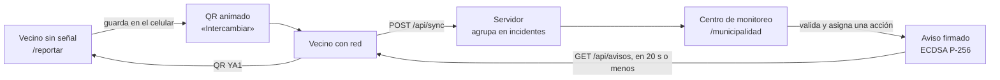

# Yaku Relay

[](https://github.com/agentards/yaku/actions/workflows/ci.yml)

Yaku es una cadena de apoyo vecinal ante el Fenómeno El Niño. El vecino reporta un incidente **sin señal** (tipo, foto y ubicación), el reporte pasa **de celular en celular por QR** y el primero que encuentra internet sube toda la cadena. La municipalidad lo ve agrupado, con cuántos vecinos lo respaldan, lo valida y responde; la respuesta vuelve por la misma cadena.

La autoridad es **el servidor**: agrupa los reportes, calcula el respaldo, guarda los estados y firma los avisos. Los celulares guardan su propia copia pero no deciden nada oficial. Los secretos (la contraseña municipal y la clave que firma los avisos) viven solo en el contenedor y en su volumen `/datos`; los celulares únicamente conocen la clave **pública**.

> **Aviso:** los reportes son **reportes vecinales por validar**. No son alertas oficiales y no reemplazan a SINPAD ni a EDAN Digital. Las capas CENEPRED son escenarios de riesgo, no daños observados; la cobertura móvil es la declarada ante OSIPTEL.

En producción: **https://yaku.lat**

## Empieza aquí

### La demo local más rápida

Requisitos: Node.js 24 (`.nvmrc`; mínimo 22.18). Compila la PWA, empaqueta el servidor y lo arranca en un solo comando.

```bash
npm ci
MUNI_PIN=un-pin-largo PORT=8787 npm run servidor
```

En PowerShell:

```powershell
npm ci
$env:MUNI_PIN = "un-pin-largo"; $env:PORT = "8787"
npm run servidor
```

Ábrelo en estas URLs (el usuario del Centro de monitoreo es `central` y su contraseña es el `MUNI_PIN`):

| URL | Qué abre |
| --- | --- |
| http://localhost:8787/ | Página pública |
| http://localhost:8787/reportar | App del vecino (PWA, funciona sin internet) |
| http://localhost:8787/municipalidad | Centro de monitoreo (`?region=piura` o `?region=lima`) |
| http://localhost:8787/estoy-bien | El vecino deja su mensaje «Estoy bien» |
| http://localhost:8787/estamos-bien | La familia busca esos mensajes por nombre |
| http://localhost:8787/app | Vista técnica 2D |
| http://localhost:8787/salud | Responde `ok` |

Para el paso a paso completo y los problemas frecuentes, lee [Primeros pasos](documentacion/PRIMEROS_PASOS.md).

## Índice de documentación

Este README es el punto de entrada. Sigue con el documento que corresponda a lo que estás haciendo:

| Documento | Úsalo cuando necesites… |
| --- | --- |
| [Arquitectura](documentacion/ARQUITECTURA.md) | Entender las piezas, los flujos de un reporte, quién es dueño de cada dato y los límites de confianza |
| [Relevo por QR](documentacion/RELEVO_QR.md) | Saber qué viaja por QR, el formato de los códigos, sus tamaños y cómo cambiarlo sin romper la cadena |
| [Agrupación y respaldo](documentacion/AGRUPACION_Y_RESPALDO.md) | Entender cómo se agrupan los reportes, cómo se calcula el respaldo de 0 a 100 y el flujo de estados |
| [API](documentacion/API.md) | Consultar endpoints, ejemplos de petición y respuesta, códigos y límites |
| [Datos](documentacion/DATOS.md) | Ver las tablas de SQLite, IndexedDB, el mapa sin red, las capas oficiales y cómo respaldar el volumen |
| [Primeros pasos](documentacion/PRIMEROS_PASOS.md) | Instalar, arrancar, verificar y probar con celulares |
| [Configuración](documentacion/CONFIGURACION.md) | Ajustar variables, parámetros de URL y textos de producto |
| [Despliegue](documentacion/DESPLIEGUE.md) | Llevarlo a Dokploy, leer los logs, comprobar un despliegue y actualizarlo |
| [Seguridad](documentacion/SEGURIDAD.md) | Revisar actores, firmas, sesión, modo estricto, privacidad y pendientes |
| [Pruebas](documentacion/PRUEBAS.md) | Correr las pruebas de la CI, los E2E y la lista para antes de un PR |

## Modelo de producto

Yaku combina seis capacidades:

1. **App del vecino** (`/reportar`): 9 tipos de incidente, gravedad, foto comprimida a JPEG de 150 KB o menos y ubicación por GPS. Todo se guarda primero en el celular (IndexedDB). Si hay personas atrapadas o heridas, primero ve los números 116 y 105.
2. **Relevo por QR** («Intercambiar»): cada celular muestra su QR y lee el del otro. Viajan reportes, estados, avisos firmados y mensajes «Estoy bien». Las fotos **no** viajan por QR: las sube el celular que las tomó cuando tiene internet.
3. **Sincronización**: con internet, el reporte sale apenas se guarda; después suben las fotos y bajan estados y avisos, cada 20 s con la app abierta. Cada registro tiene un id derivado de su contenido, así que llegar por varios caminos no lo duplica.
4. **Centro de monitoreo** (`/municipalidad`, Piura y Lima): mapa 3D, incidentes agrupados con respaldo N1–N3, validar, descartar o asignar una acción (rescate, bomberos, provisiones, maquinaria o EDAN), línea de tiempo y capas oficiales.
5. **Avisos firmados**: al asignar una acción se genera un aviso con firma ECDSA P-256. Los celulares con red lo reciben en 20 s o menos y lo pasan por QR; el celular verifica la firma sin red. El aviso dice «asignado», nunca «en camino».
6. **Estoy bien**: el vecino deja un mensaje para su familia, también sin internet, y la familia, incluso desde el extranjero, lo busca por nombre en `/estamos-bien`.



## Topología en producción

```text
Navegador o celular
        │  HTTPS 443  (yaku.lat, www.yaku.lat)
        ▼
Traefik de Dokploy ──── certificado Let's Encrypt
        │  HTTP, X-Forwarded-For
        ▼
Contenedor yaku  :8080   (node:24-alpine, usuario node)
   servidor.mjs ─── dist/  (PWA compilada)
        │
        ▼
Volumen yaku-datos  →  /datos
   yaku.db (SQLite, WAL)   fotos/   avisos-clave.json
```

Una sola imagen: la PWA compilada y un servidor Node con SQLite (`node:sqlite`), sin dependencias en tiempo de ejecución. El compose no trae Traefik ni publica puertos: el proxy y el HTTPS los pone Dokploy. Pasos, variables y logs en [Despliegue](documentacion/DESPLIEGUE.md).

## Rutas

| URL | Qué abre |
| --- | --- |
| `/` | Página pública |
| `/reportar` | App del vecino (PWA, funciona sin internet) |
| `/municipalidad` | Centro de monitoreo (usuario + contraseña municipal); `?region=piura` o `?region=lima` |
| `/estoy-bien` | El vecino deja su mensaje «Estoy bien» (también sin internet) |
| `/estamos-bien` | La familia busca esos mensajes por nombre, sin abrir la app; el enlace `?nombre=` se puede compartir |
| `/app` | Vista técnica 2D |
| `/salud` | Responde `ok` (lo usa el `HEALTHCHECK`) |

Qué pantalla abre cada ruta y sus parámetros: [Configuración](documentacion/CONFIGURACION.md#parámetros-de-la-url).

## API

| Ruta | Acceso | Para qué |
| --- | --- | --- |
| `POST /api/sync` | público | Sube reportes (idempotente por id) |
| `POST /api/fotos` | público | Foto de un reporte ya subido |
| `GET /api/estado?ids=` | público | Estado que puso la municipalidad a esos reportes |
| `GET /api/avisos`, `GET /api/avisos/clave` | público | Avisos firmados y clave pública para verificarlos |
| `POST /api/cartas`, `GET /api/cartas?q=`, `GET /api/estamos-bien?nombre=` | público | «Estoy bien»: búsqueda desde 3 letras, nunca un listado completo |
| `GET /api/stats`, `GET /api/reports` | público | Conteos; reportes por id o desde una fecha (en modo estricto, el histórico pide sesión) |
| `POST` / `GET` / `DELETE /api/sesion` | — | Entrar (usuario + contraseña → token), quién soy, salir |
| `GET /api/incidentes`, `POST /api/incidentes/:id/(estado\|unir\|separar)`, `GET /api/fotos/:id` | sesión o PIN | Centro de monitoreo |

Ejemplos, códigos de error y límites en [API](documentacion/API.md).

## Mapa del repositorio

```text
src/                  PWA
  poblador/             app del vecino: reporte, Intercambiar, avisos, Estoy bien
  vista3d/              mapa 3D y Centro de monitoreo
  auth/  estamos-bien/  landing/
  codec.ts  scanner.ts  formato YR1, lector de QR
servidor-local/       servidor Node + SQLite (API, agrupación, avisos, sesión)
  pruebas/              pruebas con node --test
server/               Worker de Cloudflare (alternativa mínima)
tests/                pruebas de la PWA con Vitest
scripts/              E2E con Chrome, QA de despliegue, preparación de datos
public/               mapa base .pmtiles, capas oficiales, iconos
data/basemap/         licencia y atribución del mapa base
documentacion/        guías detalladas (ver el índice)
.github/  .githooks/  CI y hook de commits
Dockerfile  docker-compose.yml  yaku.env.ejemplo
app.html  index.html  estamos-bien.html   páginas de entrada de Vite
audit421.py  build421.py   preparación de datos del Aviso 421 de CENEPRED
```

## Comandos

```bash
npm ci
npm run dev                  # http://localhost:5173, reenvía /api al servidor local
npm run typecheck && npm run typecheck:servidor
npm test                     # build + vitest
npm run test:servidor        # API, sesión, agrupación, fotos, avisos, «Estoy bien», seguridad
npm run servidor             # build + servidor local (MUNI_PIN y PORT por variable)
npm run qa:despliegue        # simula los despliegues de Dokploy
npm run qa:produccion -- https://yaku.lat
```

La lista de E2E con Chrome está en [Pruebas](documentacion/PRUEBAS.md#e2e-con-chrome).

## Alcance

Incluye:

- reporte sin internet con foto y GPS, relevo por QR y sincronización idempotente;
- agrupación en incidentes con respaldo N1–N3, estados, acciones, unir y separar;
- avisos firmados que vuelven por la cadena, y mensajes «Estoy bien» buscables por nombre;
- sesión por usuario y contraseña, PIN de respaldo y modo estricto opcional;
- mapa base y capas oficiales que funcionan sin red;
- una imagen Docker lista para Dokploy.

No incluye (hoy):

- fotos por QR: solo suben por internet;
- roles distintos de «operador», ni rotación o revocación de la clave de avisos;
- copias automáticas de la base: el respaldo es manual, con `VACUUM INTO`;
- incidentes, fotos, avisos ni sesión en la versión de Cloudflare;
- protecciones del modo estricto activadas por defecto;
- licencia del código definida.

Los pendientes de seguridad están en [Seguridad](documentacion/SEGURIDAD.md#pendientes-y-límites-conocidos). La alternativa en Cloudflare está en [Despliegue](documentacion/DESPLIEGUE.md#alternativa-cloudflare-pages).

## Verificación

Antes de abrir un pull request o de una demo:

```bash
npm run typecheck
npm run typecheck:servidor
npm test
npm run test:servidor
node servidor-local/empaquetar.mjs
```

Es lo que corre la CI. Luego haz la prueba manual de humo de [Pruebas](documentacion/PRUEBAS.md#prueba-manual-de-humo).

## Convenciones de documentación

- Este README es el índice y el contrato de alto nivel. El detalle va en `documentacion/`.
- La carpeta se llama `documentacion/` y **no** `docs/` a propósito: `docs/` está en `.gitignore` y en `.dockerignore` porque ahí caen las capturas de los E2E.
- Los documentos están en español, con el tono del código, y usan diagramas Mermaid que GitHub dibuja solo.
- Todo dato (reglas, cifras, endpoints, columnas, límites, textos) sale del código. Si cambias el comportamiento, actualiza el documento y los enlaces en el mismo cambio.
- Nunca subas un `.env` ni valores reales de variables al repositorio.
- Los commits usan Conventional Commits, en inglés, y **sin** líneas de co-autoría de IA. El hook `.githooks/commit-msg` las rechaza: actívalo con `git config core.hooksPath .githooks`.

## Licencia y atribuciones

- **Código:** licencia por definir.
- **Datos y mapas:** © colaboradores de OpenStreetMap (ODbL), mapa base vía Protomaps (ver `data/basemap/LICENSE_BASEMAP.md`); SENAMHI y CENEPRED/SIGRID vía el geoservicio de INDECI; centros poblados del IGN; cobertura móvil de OSIPTEL (Datos Abiertos, ODC-By).
