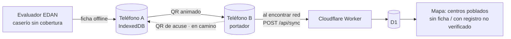

# Yaku Relay

[](https://github.com/hallzyx/yaku/actions/workflows/ci.yml)

> **¿Recibes el repo?** Lee primero [HANDOFF.md](HANDOFF.md).

Yaku Relay es una PWA que sigue funcionando sin internet. Sirve para sacar **fichas de Evaluación Rápida de daños (EDAN)** de caseríos andinos sin cobertura móvil: la ficha pasa **de teléfono en teléfono por QR** hasta que alguno encuentra red y la consolida en el servidor sin duplicados. Un mapa muestra qué centros poblados del escenario de riesgo CENEPRED **todavía no tienen ficha de evaluación**.

> **Aviso de datos.** Las fichas de Yaku Relay son registros de campo **no verificados**: no son alertas oficiales ni reemplazan a SINPAD ni a EDAN Digital (INDECI). Las capas CENEPRED son **escenarios de riesgo** (hipótesis de planificación), no daños observados. La cobertura móvil es la **declarada por las operadoras ante OSIPTEL**, no medida en campo. La app nunca califica una vía como segura o transitable.

- **Producción:** https://yaku-relay-proto.pages.dev/
- **Hackathon:** Hack the Andes 2026 · Track 01 Clima y Territorio · Lima

## Empieza aquí

### Probar la demo en 60 segundos
1. Abre la URL **con internet** y espera el aviso «Mapa base guardado sin red · 2,6 MB».
2. Activa el **modo avión** y recarga: la app y el mapa de Piura vuelven a abrir.
3. **Registrar:** crea un registro con GPS. Queda guardado en el teléfono como «NO VERIFICADO».
4. **Relevo:** muestra el QR y léelo desde otro teléfono o laptop, también sin red.
5. **Sync:** vuelve a conectar el segundo equipo. El registro llega a la base una sola vez; puedes comprobarlo en `/api/stats`.

### Correrlo en local
Requisitos: Node.js 20 o 22 y npm 10.
```bash
npm ci
npm run dev                         # http://localhost:5173 (sin service worker)
npm run build && npm run preview    # http://localhost:4173 (con service worker, offline real)
npm test                            # build + vitest (codec, IndexedDB, Worker+D1 falso, bundle, basemap)
npm run typecheck                   # tsc
npm run e2e                         # build + Playwright, Android 412x915 (usa /usr/bin/google-chrome o CHROME=…)
npm run e2e:desktop                 # build + Playwright, 1280x800
```
Más comandos (medición QR, preparación de datos, build del Worker): [docs/README-TECNICO.md](docs/README-TECNICO.md).

## Índice de documentación

| Documento | Para… |
|---|---|
| [Producto](docs/PRODUCTO.md) | Ver el problema, el usuario, por qué un QR y qué buscamos |
| [Estado actual](docs/ESTADO.md) | Saber qué funciona hoy, qué está en camino y qué no se probó |
| [Arquitectura](docs/ARQUITECTURA.md) | Entender los componentes, flujos, el formato del QR y la API |
| [Datos y fuentes](docs/DATOS.md) | Ver el origen de cada capa, sus cifras, licencias y límites |
| [Decisiones y trade-offs](docs/DECISIONES.md) | Ver por qué cada tecnología y qué sacrificamos |
| [Pruebas](docs/PRUEBAS.md) | Correr los tests y E2E, y hacer la prueba manual con 2 teléfonos |
| [Seguridad y límites](docs/SEGURIDAD.md) | Ver qué garantiza la app, qué no y qué no se debe afirmar |
| [Guion de demo](docs/DEMO.md) | Preparar el recorrido de 3 minutos con plan B |

## Flujo en una imagen

El QR de acuse y los estados del mapa están en construcción; ver [Estado actual](docs/ESTADO.md).

## Licencia y atribuciones
- **Código:** por definir. Brayan elige la licencia; mientras tanto, no asumir ninguna.
- **Atribuciones:** © colaboradores de OpenStreetMap (ODbL), con el mapa base vía Protomaps. SENAMHI y CENEPRED/SIGRID se obtienen vía el geoservicio de INDECI. La cobertura móvil viene de OSIPTEL (Datos Abiertos, ODC-By). El detalle está en [Datos y fuentes](docs/DATOS.md).
