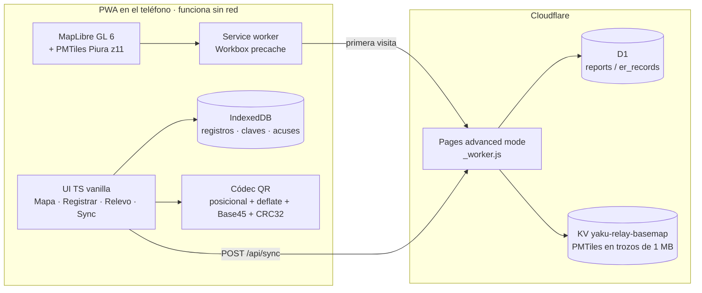
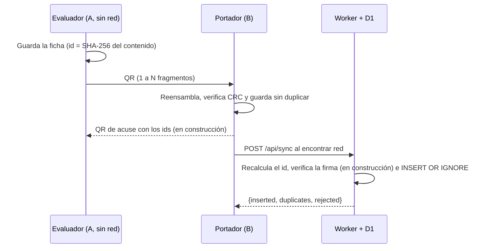

# Arquitectura

## Contexto

## Componentes
| Componente | Responsabilidad |
|---|---|
| `src/main.ts` | Pestañas, flujo de registro, relevo y sincronización |
| `src/codec.ts` | Codificación posicional, `deflateRaw` (pako), Base45, CRC32 y fragmentación en QR animado |
| `src/db.ts` | IndexedDB con deduplicación (`putIfAbsent`) |
| `src/sync.ts` | Consolidación diferida cuando vuelve la red |
| `src/scanner.ts` | Lectura de QR con BarcodeDetector cuando existe y jsQR como respaldo |
| `src/map.ts`, `src/layers.ts`, `src/basemap*.ts` | MapLibre, capas oficiales con fuente y fecha, y mapa base PMTiles guardado en Cache Storage |
| `server/worker.ts` | API `/api/*`, servicio del mapa base desde KV y archivos estáticos |

## Vista 3D (rama `feat/3d-portal`, aditiva)
| Componente | Responsabilidad |
|---|---|
| `src/vista3d/conmutador.ts` | Control 2D\|3D sobre el mismo mapa (`?vista=3d`); degrada a 2D sin WebGL 2, sin DEM guardado y sin red, o si se pierde el contexto |
| `src/vista3d/relieve.ts` | Terreno DEM 1,6×, color por altitud, sombreado y cielo con bruma; las capas reales quedan drapeadas |
| `src/vista3d/dem.ts` | DEM Terrarium de Piura (2,9 MB) por `yakudem://`, guardado completo en Cache Storage con sha256 |
| `src/vista3d/camara.ts` | Vuelo regional → acercamiento → órbita, cancelable por cualquier gesto |
| `src/vista3d/escena.ts` | Escena `EscenaYaku` para el portal de campo (`src/vista3d/ui/`) |

Detalle, presupuesto y fps: `docs/evidencia-3d/analisis-codigo.md`.

## Flujo de relevo

## API
| Ruta | Descripción |
|---|---|
| `POST /api/sync` | `{records:[…]}`. Valida cada registro y recalcula su id; rechaza los manipulados. Responde `{accepted, inserted, duplicates, rejected}` |
| `GET /api/stats` | Contadores |
| `GET /api/reports?limit=50` o `?ids=a,b` | Lectura de registros |
| `GET /basemap/*.pmtiles` | Mapa base desde KV, con soporte de Range |
| *(PRD)* `POST /api/er/sync`, `GET /api/er/status`, `GET /api/er/records?ccpp=` | Fichas `er1` firmadas y estado por centro poblado |

## Modelo de la ficha `er1` (en construcción)
Subconjunto del Anexo 01 con estos campos:

- centro poblado y ubigeo, tipo de peligro y hora del evento, coordenadas con su precisión;
- afectadas y damnificadas;
- lesionados, atrapados, aislados, desaparecidos y fallecidos, donde `null` significa «no evaluado», que no es lo mismo que 0;
- viviendas;
- vía: solo `interrumpida` o `sin_evaluar`;
- servicios interrumpidos y necesidades, guardados como bitmask;
- nota, alias del autor (sin DNI), clave pública, firma e id.

El esquema completo está en el PRD (`prd/PRD-yaku-relay-edan.md`, sección 4).
