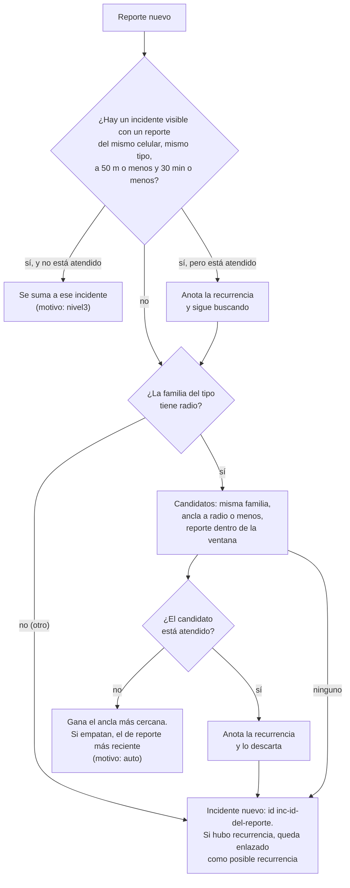
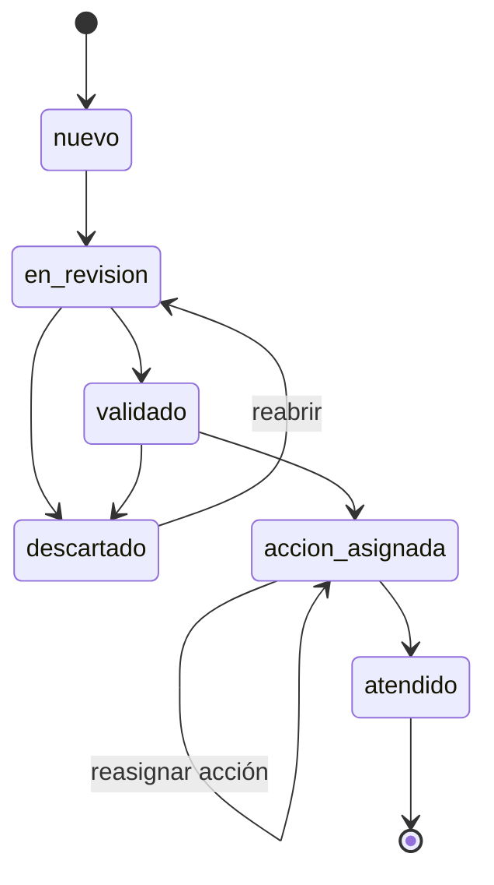

# Agrupación y respaldo

Cuando varios vecinos reportan lo mismo, la municipalidad no debería ver diez filas sino un incidente con cuántos vecinos lo respaldan. Este documento explica cómo el servidor agrupa los reportes, cómo calcula el **respaldo de 0 a 100**, en qué orden pone la bandeja y por qué estados pasa un incidente.

El código está en `servidor-local/`: `agrupacion.ts` (lógica pura), `reglas.ts` (todas las cifras), `almacen.ts` (asigna al llegar), `vista.ts` (arma la respuesta), `estados.ts` (flujo de estados) y `avisos.ts`. Los reportes crudos **nunca se borran**: un incidente es solo una asignación reporte → incidente que el operador puede corregir.

## Camino rápido

1. Un reporte llega por `POST /api/sync`. Si es nuevo, `asignarPendientes` lo manda a un incidente existente o abre uno.
2. Cada vez que el Centro de monitoreo consulta `GET /api/incidentes`, el servidor **recalcula** el respaldo con la hora actual.
3. Al **validar**, el respaldo se congela. Desde ahí la prioridad no baja con el tiempo.
4. Si el operador asigna una acción o da el incidente por atendido, el servidor firma un [aviso](#qué-transición-dispara-un-aviso).

## Familias

El tipo de cada reporte pertenece a una familia. La familia fija el radio, la ventana y la vida media del puntaje.

| Familia | Tipos que incluye | Radio al ancla | Ventana | Vida media |
| --- | --- | ---: | ---: | ---: |
| `agua` | `agua`, `cauce`, `huaico`, `via_bloq` | 250 m | 3 h | 3 h |
| `vivienda` | `vivienda` | 100 m | 12 h | 12 h |
| `heridos` | `heridos` | 100 m | 12 h | 12 h |
| `atrapados` | `atrapados` | 50 m | 12 h | 12 h |
| `ayuda` | `ayuda` | 150 m | 24 h | 24 h |
| `otro` | `otro` | no agrupa | 3 h | 3 h |

- Casa dañada y heridos son **familias distintas** a propósito: piden respuestas diferentes (bomberos o EDAN frente a una ambulancia).
- `atrapados` nunca se agrupa con otro tipo.
- `otro` no agrupa entre personas; solo une actualizaciones de la misma persona (nivel 3).
- El **ancla** es la posición del primer reporte del incidente. El radio se mide siempre contra el ancla, no contra el último reporte.

## A qué incidente va un reporte

`elegirIncidente` decide, en este orden:



- **Nivel 3** es la misma persona que actualiza su reporte: mismo `device_id`, mismo tipo, a 50 m o menos y a 30 min o menos de otro reporte del incidente.
- **La ventana** se mide contra el rango de horas del incidente: el reporte nuevo debe caer entre (el más antiguo − ventana) y (el más reciente + ventana).
- Un incidente **atendido** no absorbe reportes nuevos. Si el reporte coincidía con uno, el incidente nuevo queda enlazado en `recurrencia_de` y la bandeja lo marca como posible recurrencia.
- El id de un incidente es `inc-` más el id de su primer reporte (`inc-1qo3dv8496w`). Si ya existe, se agrega `-2`, `-3`…

Ejemplos verificados con `elegirIncidente` y un incidente de casa dañada anclado en el punto 0 (reportes de casa dañada):

| Reporte nuevo | Resultado |
| --- | --- |
| Mismo celular, a 30 m, 20 min después | Se suma (`nivel3`) |
| Otro celular, a 90 m, 1 h después | Se suma (`auto`) |
| Otro celular, a 130 m | Incidente nuevo (pasa los 100 m de la familia) |
| Otro celular, a 20 m, 14 h después | Incidente nuevo (pasa la ventana de 12 h) |
| Otro celular, a 90 m, pero el incidente está atendido | Incidente nuevo con `recurrencia_de` |

## Hora efectiva

El celular escribe `ts` en segundos y el servidor anota `received_at` en milisegundos al recibirlo. Para agrupar y para el decaimiento se usa la **hora efectiva**:

- Normalmente es la del celular (`ts × 1000`).
- Si esa hora viene **más de 10 minutos en el futuro** respecto a la llegada (`relojFuturoMaxMin`), el celular tiene el reloj mal puesto y se usa la hora de llegada.

Los reportes se procesan ordenados por hora efectiva y, a igual hora, por id: el resultado es el mismo sin importar en qué orden llegaron.

## Unir y separar

El operador puede corregir lo que el algoritmo decidió:

| Acción | Qué hace | Queda registrado |
| --- | --- | --- |
| **Unir** `A` con `B` | Los reportes de `B` pasan a `A` (motivo `manual`) y `B` se oculta con `unido_a = A` | Tabla `ajustes`: tipo `unir`, quién y cuándo |
| **Separar** reportes de `A` | Crea `inc-<primer-reporte>-s` (o `-s2`…), con ese reporte como ancla, y mueve ahí los reportes elegidos | Dos filas en `ajustes`: `separar` en `A` y `separado_de` en el nuevo |

Unir no mezcla los estados: el incidente que queda conserva el suyo.

## Respaldo de 0 a 100

El respaldo mide cuántos vecinos distintos coinciden, no qué tan grave es. La severidad **no suma**: solo ordena la bandeja.

```text
respaldo = redondear( (Personas + Fotos + Cercanía) × Recencia ), entre 0 y 100
```

De cada celular cuenta **solo su último reporte** (fija su posición y su severidad), y un celular aporta como máximo una persona y una foto.

| Componente | Cómo se calcula | Puntos |
| --- | --- | --- |
| **Personas** (celulares distintos) | 1 / 2 / 3 / 4 o más | 25 / 40 / 50 / 55 |
| **Fotos** (celulares con al menos una foto **recibida**) | 1 / 2 o más | 15 / 25 |
| **Cercanía** (solo con 2 o más personas) | Mediana de las distancias de los últimos reportes al ancla: 50 m o menos / 100 m o menos / dentro del radio de la familia | 20 / 12 / 5 |
| **Recencia** | `0,5 ^ (horas desde el último reporte ÷ vida media)`, con piso de 0,2 | factor de 0,2 a 1 |

Una marca `(con foto)` sin la imagen recibida **suma 0** hasta que la foto llega al servidor; mientras tanto el incidente la cuenta en `fotos_pendientes`.

### Niveles

| Nivel | Desde | Cómo lo ve el vecino |
| --- | ---: | --- |
| N1 | 0 | «1 vecino lo reporta» |
| N2 | 45 | «N vecinos lo reportan» |
| N3 | 80 | «N vecinos coinciden · M fotos · cerca uno del otro» |

Al vecino se le muestra el nivel **en palabras**, nunca el número, y nunca en rojo: un reporte vecinal no es una alerta oficial. El número va solo al Centro de monitoreo.

### Ejemplos calculados

Resultados de ejecutar `respaldo()` de `servidor-local/agrupacion.ts` con las reglas por defecto. La hora «ahora» es el momento del último reporte salvo que se indique.

| Caso | Personas | Fotos | Cercanía | Recencia | Total | Nivel |
| --- | ---: | ---: | ---: | ---: | ---: | --- |
| A. 1 vecino con casa dañada | 25 | 0 | 0 | 1 | **25** | N1 |
| B. 2 vecinos, el segundo a 40 m (mediana 20 m) | 40 | 0 | 20 | 1 | **60** | N2 |
| C. 3 vecinos a menos de 50 m, 2 con foto recibida | 50 | 25 | 20 | 1 | **95** | N3 |
| D. 4 vecinos de agua a menos de 50 m, 6 h después | 55 | 0 | 20 | 0,25 | **19** | N1 |
| D2. Lo mismo, 40 h después | 55 | 0 | 20 | 0,2 (piso) | **15** | N1 |
| E. 2 vecinos de agua, uno a 200 m (mediana 100 m) | 40 | 0 | 12 | 1 | **52** | N2 |
| F. 2 vecinos de agua, uno a 240 m (mediana 120 m) | 40 | 0 | 5 | 1 | **45** | N2 |
| G. 1 vecino con 3 reportes y foto | 25 | 15 | 0 | 1 | **40** | N1 |

Cómo salen algunos, a mano:

- **D**: agua tiene vida media de 3 h, así que 6 h son dos vidas medias y la recencia es 0,5² = 0,25. Entonces (55 + 0 + 20) × 0,25 = 18,75, que redondea a 19. Un incidente viejo de 4 personas cae a N1 por antigüedad.
- **E**: con dos puntos a 0 m y a 200 m del ancla, la mediana es 100 m, que entra en «100 m o menos» → 12 puntos.
- **F**: con 0 m y 240 m la mediana es 120 m, que pasa los 100 m pero sigue dentro del radio de agua (250 m) → 5 puntos. El total, 45, es justo el umbral de N2.

### Congelado al validar

Cuando el incidente llega a `validado`, `accion_asignada` o `atendido`, el servidor usa el respaldo **guardado en la fila de la validación** y recalcula el nivel con ese número. Así una validación hecha con 60 puntos no baja a 15 por pasar las horas, y la fila queda como dato histórico (`respaldo_congelado: true`).

## Prioridad de la bandeja

La bandeja ordena por estas claves, en este orden:

1. **Abiertos antes que cerrados** (`descartado` y `atendido` van al final).
2. **Riesgo de vida**: `atrapados`, luego `heridos`, luego el resto.
3. **Severidad** más alta primero.
4. **Respaldo** más alto primero.
5. **Último reporte** más reciente primero.
6. El id, para que el orden sea siempre el mismo.

El tipo principal de un incidente es el más grave de la lista `atrapados, heridos, vivienda, huaico, via_bloq, cauce, agua, ayuda, otro`.

## Estados de un incidente



`nuevo` es el estado de un incidente sin ninguna fila en `estados`. Cada cambio guarda quién (`quien` y `usuario`), cuándo, el motivo y el respaldo de ese momento.

### Errores de `POST /api/incidentes/:id/estado`

Primero comprueba la sesión y que el incidente exista. Después valida el cuerpo en este orden:

| Código | Cuándo | Mensaje |
| --- | --- | --- |
| 404 | El incidente no existe | `incidente no encontrado` |
| 400 | `estado` no es uno de los seis | `estado desconocido` |
| 400 | Falta `quien` o pasa de 60 caracteres | `falta «quien» (1–60 caracteres)` |
| 400 | `motivo` pasa de 200 caracteres | `motivo demasiado largo` |
| 400 | `accion` no es `rescate`, `bomberos`, `provisiones`, `maquinaria` ni `edan` | `acción desconocida` |
| 409 | La transición no está en el diagrama | `no se puede pasar de X a Y` (con el `estado` actual) |
| 400 | Descartar sin motivo | `descartar exige motivo` |
| 400 | `accion_asignada` sin acción | `falta la acción (rescate, bomberos, provisiones, maquinaria, edan)` |
| 401 / 403 | Sin sesión o con PIN incorrecto | Ver [API](API.md#niveles-de-acceso) |

`evaluacion_edan` se acepta como alias de `edan`. Si el estado no es `accion_asignada`, la acción se ignora.

## Qué transición dispara un aviso

| Transición | Aviso |
| --- | --- |
| `→ accion_asignada` con acción `rescate`, `bomberos`, `provisiones`, `maquinaria` o `edan` | Sí, con esa acción |
| `→ atendido` | Sí, con la acción `atendido` |
| `→ en_revision`, `→ validado`, `→ descartado` | No |

El aviso lleva el tipo y la posición del ancla (a 4 decimales), el minuto, un texto opcional del operador (hasta 120 caracteres) y la firma. Su id es el hash de `incidente|acción|minuto`: asignar la misma acción dos veces en el mismo minuto no crea dos avisos.

El texto que ve el vecino dice **«asignado»**: «Rescate asignado», «Bomberos asignados», «Provisiones asignadas», «Maquinaria asignada», «Evaluación EDAN asignada» e «Incidente atendido». Nunca «en camino»: Yaku solo sabe que la municipalidad asignó la acción, y prometer una llegada a alguien atrapado que luego no ocurre es peor que decir menos.

## Estimación en el celular

El celular no ve a todos los vecinos, así que `src/poblador/confianza.ts` **estima** con los reportes que lleva:

- Usa las mismas familias, radios y ventanas, pero mide el radio contra el reporte de referencia y no contra un ancla.
- Cuenta celulares distintos del **autor**: pasar un reporte por QR no suma vecinos.
- Con 1 vecino muestra N1, con 2 muestra N2 y con 3 o más muestra N3 (`nivelLocal`).
- Cuando llega el estado del servidor, el número del servidor manda.

## Ajustar las reglas

Todas las cifras de este documento viven en `servidor-local/reglas.ts`. Para cambiarlas sin tocar código, `YAKU_REGLAS` acepta un JSON parcial que se mezcla con las de fábrica:

```json
{ "niveles": { "n2": 40, "n3": 75 }, "familias": { "agua": { "tipos": ["agua", "cauce", "huaico", "via_bloq"], "radioM": 300, "ventanaH": 3, "mediaVidaH": 3 } } }
```

- `familias`, `nivel3` y `niveles` se mezclan por clave: de una familia hay que dar el objeto completo.
- Las listas (`personasPts`, `fotosPts`, `cercania`, `gravedad`, `riesgoVida`) se **reemplazan** enteras.
- Un JSON inválido no tumba el servidor: avisa en consola y usa las reglas por defecto.

## Documentos relacionados

- [API](API.md): `GET /api/incidentes` y los endpoints de estado, unir y separar.
- [Datos](DATOS.md): las tablas `incidentes`, `asignaciones`, `estados`, `ajustes` y `avisos`.
- [Configuración](CONFIGURACION.md): `YAKU_REGLAS` junto al resto de las variables.
