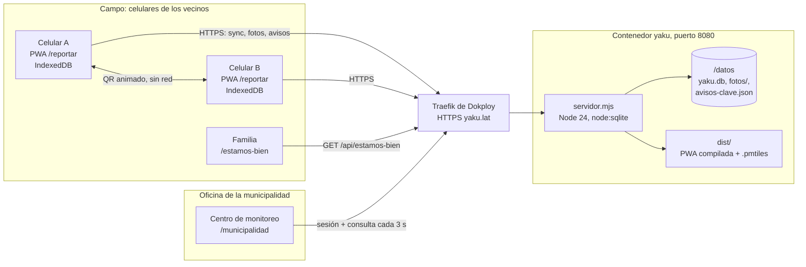
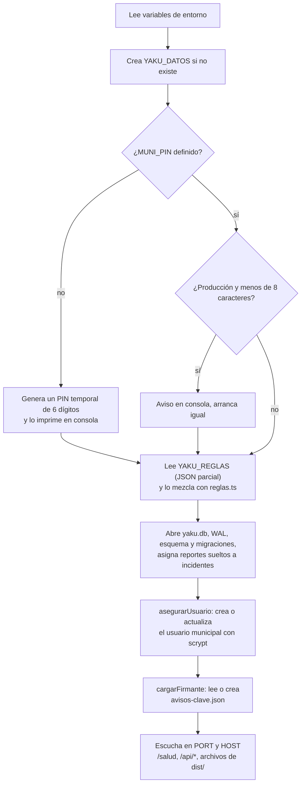
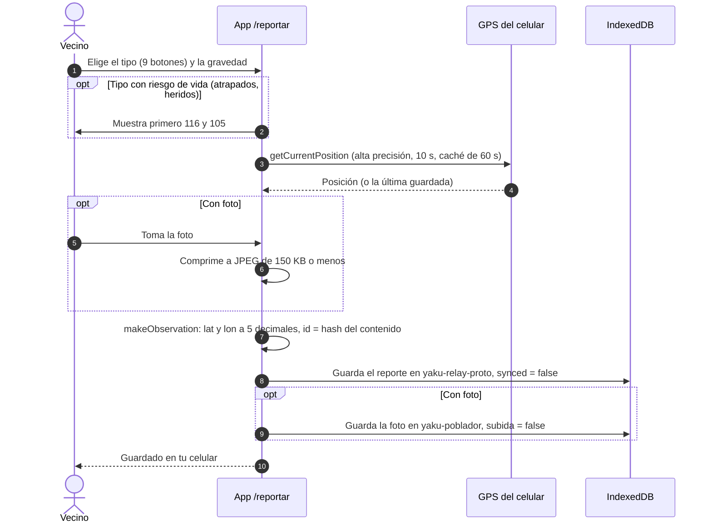
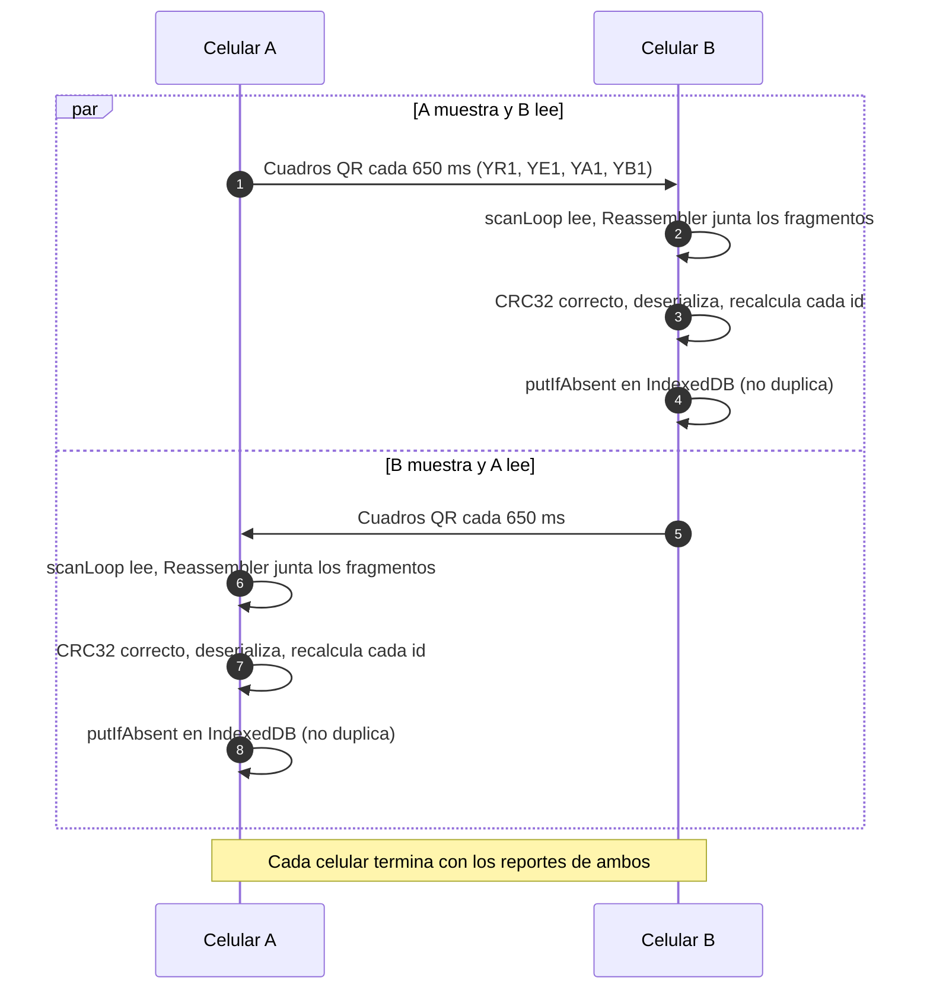
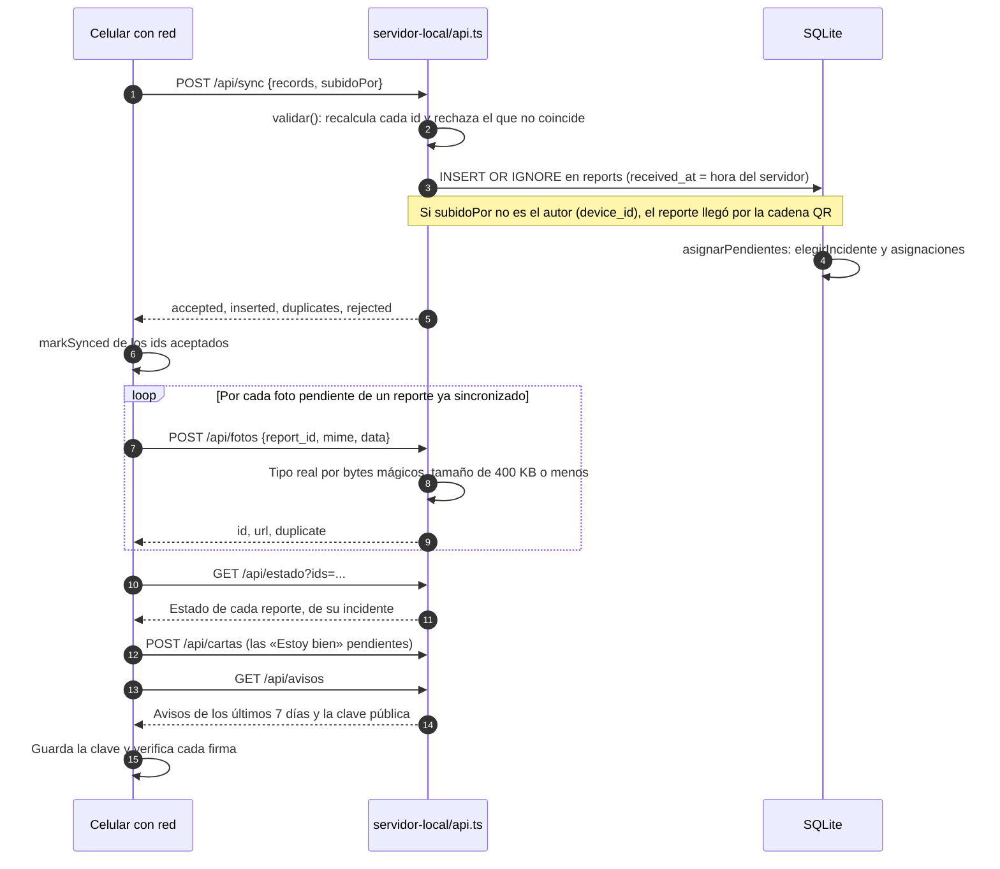
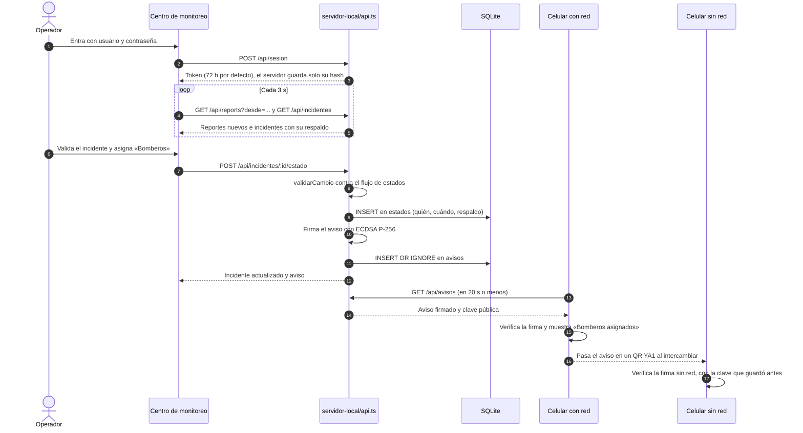
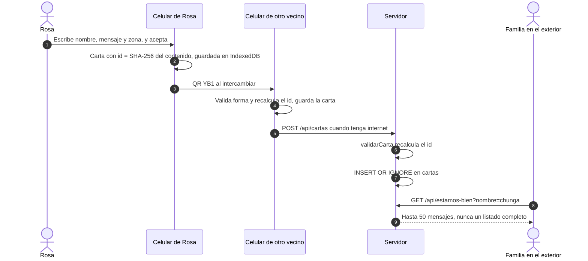
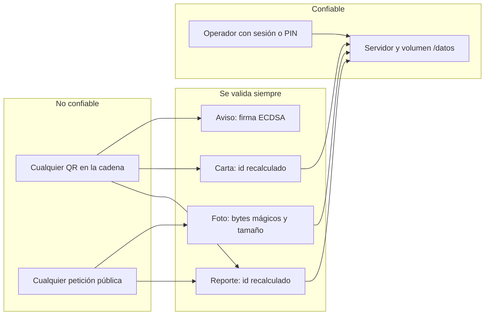

# Arquitectura de Yaku

Yaku es una cadena de apoyo vecinal: un reporte nace en un celular **sin señal**, pasa de celular en celular por QR y llega a la municipalidad cuando cualquiera de esos celulares encuentra internet. Este documento explica qué piezas hay, quién es dueño de cada dato y dónde están los límites de confianza.

La autoridad sobre los incidentes, los estados y los avisos es **el servidor** (`servidor-local/`, un solo proceso Node con SQLite). El celular guarda su propia copia y la manda cuando puede, pero nunca decide nada oficial. Los secretos (contraseña municipal, clave de firma de avisos) viven solo en el contenedor y en su volumen `/datos`.

## Camino rápido

1. Mira el [contexto del sistema](#contexto-del-sistema) y la [tabla de componentes](#componentes).
2. Sigue la secuencia que te interese: [reportar sin señal](#1-reportar-sin-señal), [relevo por QR](#2-relevo-por-qr-entre-dos-celulares), [sincronización](#3-sincronización-con-internet), [respuesta municipal](#4-respuesta-municipal-y-aviso-firmado) o [«Estoy bien»](#5-estoy-bien).
3. Para saber quién guarda qué, ve a [quién es dueño de cada dato](#quién-es-dueño-de-cada-dato); para qué se cree y qué no, a [límites de confianza](#límites-de-confianza).

## Contexto del sistema

## Componentes

| Componente | Dónde está | Qué hace | ¿Tiene secretos? |
| --- | --- | --- | --- |
| App del vecino | `src/poblador/`, `src/codec.ts`, `src/db.ts`, `src/sync.ts`, `src/scanner.ts` | Reporta sin red, guarda en IndexedDB, muestra y lee QR, sincroniza cada 20 s con red, verifica avisos firmados | No. Guarda un código anónimo del equipo (`yaku-device`) y la **clave pública** de avisos |
| Centro de monitoreo | `src/vista3d/monitoreo/`, `src/vista3d/municipalidad/`, `src/auth/sesion.ts` | Mapa 3D, bandeja de incidentes, validar y asignar acciones. Consulta al servidor cada 3 s | No. Guarda el **token de sesión** en `localStorage` |
| Página de la familia | `src/estamos-bien/`, `estamos-bien.html` | Busca mensajes «Estoy bien» por nombre, sin abrir la app | No |
| Página pública | `src/landing/`, `index.html` | Presenta el proyecto | No |
| Servidor | `servidor-local/` (`servidor.ts`, `api.ts`, `almacen.ts`, `agrupacion.ts`, `reglas.ts`, `estados.ts`, `vista.ts`, `avisos.ts`, `cartas.ts`, `usuarios.ts`, `estaticos.ts`) | API, agrupación en incidentes, respaldo 0–100, estados, firma de avisos, sesiones y archivos estáticos | **Sí**: `MUNI_PIN`, `MUNI_CLAVE`, clave privada de avisos |
| Base y fotos | Volumen `yaku-datos` montado en `/datos` | `yaku.db` (SQLite en modo WAL), `fotos/`, `avisos-clave.json` | **Sí**: hashes de contraseña y de sesión, clave privada |
| PWA compilada | `dist/` dentro de la imagen | HTML, JS, CSS, mapa base y capas. El servicio worker la deja sin red | No |
| Proxy HTTPS | Traefik de Dokploy (fuera del repo) | Termina TLS y reenvía al puerto 8080 con `X-Forwarded-For` | Certificado de Let's Encrypt |
| Worker de Cloudflare | `server/worker.ts` | Alternativa mínima: solo `/api/sync`, `/api/stats`, `/api/reports`. Ver [API](API.md#diferencias-con-el-worker-de-cloudflare) | Bindings D1 y KV |

## Arranque del servidor

`iniciar()` en `servidor-local/servidor.ts` hace esto, en orden:

- Una variable vacía cuenta como no definida: Dokploy pasa `MUNI_CLAVE` como cadena vacía y el servidor arranca igual, con la contraseña igual al PIN.
- Un usuario mal escrito no tumba el arranque: queda solo el PIN de respaldo.
- Si el cuerpo de una petición `/api/*` pasa de **640 KB**, responde 413 y corta la conexión (cabe una foto de 400 KB en base64 más el JSON).
- Con `SIGINT` o `SIGTERM` cierra el servidor y la base. Si no termina en 2 s, sale igual.
- La IP del cliente sale de `X-Forwarded-For` (último salto) **solo** si quien conecta es una red privada, como Traefik dentro de Docker. Si conecta directo desde internet, lo que mande el cliente se ignora.

## Secuencias

### 1. Reportar sin señal

Si el tipo del botón no existe en el codec, se guarda como `otro` con el nombre al inicio de la nota. Con foto, la nota termina en `(con foto)`: la foto no viaja por QR, pero quien recibe el reporte sabe que existe.

### 2. Relevo por QR entre dos celulares

Los dos celulares muestran su QR y leen el del otro **a la vez**. Todo ocurre sin internet.

Detalles del formato en [Relevo por QR](RELEVO_QR.md).

### 3. Sincronización con internet

`sincronizar()` corre al abrir la app, cada 20 s con la pestaña visible, al volver la red y después de guardar o recibir un reporte. El reporte nuevo sale primero (`enviarYa`), sin esperar a una foto que se esté subiendo.

`subidoPor` es lo que permite al servidor contar, por incidente, cuántos reportes llegaron `por_cadena`.

### 4. Respuesta municipal y aviso firmado

El aviso dice «asignado», nunca «en camino»: Yaku sabe que la municipalidad asignó la acción, no que el equipo ya salió.

### 5. «Estoy bien»

## Quién es dueño de cada dato

| Dato | Lo crea | Dónde vive | Quién manda si hay diferencias |
| --- | --- | --- | --- |
| Reporte (`Observation`) | El celular que lo escribe | IndexedDB del celular y tabla `reports` | Nadie lo cambia: el id es un hash del contenido |
| Foto | El celular que la tomó | IndexedDB del celular y `/datos/fotos/` | El servidor guarda lo que llegó, con su tipo real |
| Hora del celular (`ts`) | El celular | `reports.ts` | El servidor la corrige si viene más de 10 min en el futuro (ver [hora efectiva](AGRUPACION_Y_RESPALDO.md#hora-efectiva)) |
| Hora de llegada (`received_at`) | El servidor | `reports.received_at` | El servidor |
| Incidente y asignaciones | El servidor | Tablas `incidentes` y `asignaciones` | El servidor. El operador puede corregir con unir y separar |
| Respaldo 0–100 y nivel | El servidor | Se calcula en cada consulta | El servidor. El celular solo estima con lo que tiene |
| Estado y acción | El operador | Tabla `estados` | El servidor. El celular guarda el más reciente que le llegó |
| Aviso firmado | El servidor | Tabla `avisos` | El servidor, por su firma |
| «Estoy bien» | El vecino | IndexedDB y tabla `cartas` | Nadie: lo escribió quien firma y la municipalidad no lo verifica |
| Usuario y sesión | El servidor al arrancar | Tablas `usuarios` y `sesiones` | Las variables de entorno |

Las tablas completas están en [Datos](DATOS.md).

## Límites de confianza

- **Un reporte es solo un reporte vecinal por validar.** Nada en la cadena lo vuelve oficial; solo el operador lo valida.
- **Los avisos oficiales no se pueden fabricar en la cadena**: el celular los muestra como de la municipalidad solo si la firma coincide con la clave pública que guardó.
- **Las cartas «Estoy bien» no son oficiales.** Su id impide cambiar el texto, pero no prueba quién las escribió.
- **Las fotos y el histórico exacto** (ubicación y nota de cada vecino) pasan por la sesión. En modo estricto, el histórico también.

Más detalle en [Seguridad](SEGURIDAD.md).

## Documentos relacionados

- [Relevo por QR](RELEVO_QR.md): formato de los códigos y reensamblado.
- [Agrupación y respaldo](AGRUPACION_Y_RESPALDO.md): cómo se arman los incidentes y se calcula el puntaje.
- [API](API.md): endpoints, ejemplos y límites.
- [Datos](DATOS.md): SQLite, IndexedDB y mapa sin red.
- [Seguridad](SEGURIDAD.md): actores, firmas y modo estricto.
