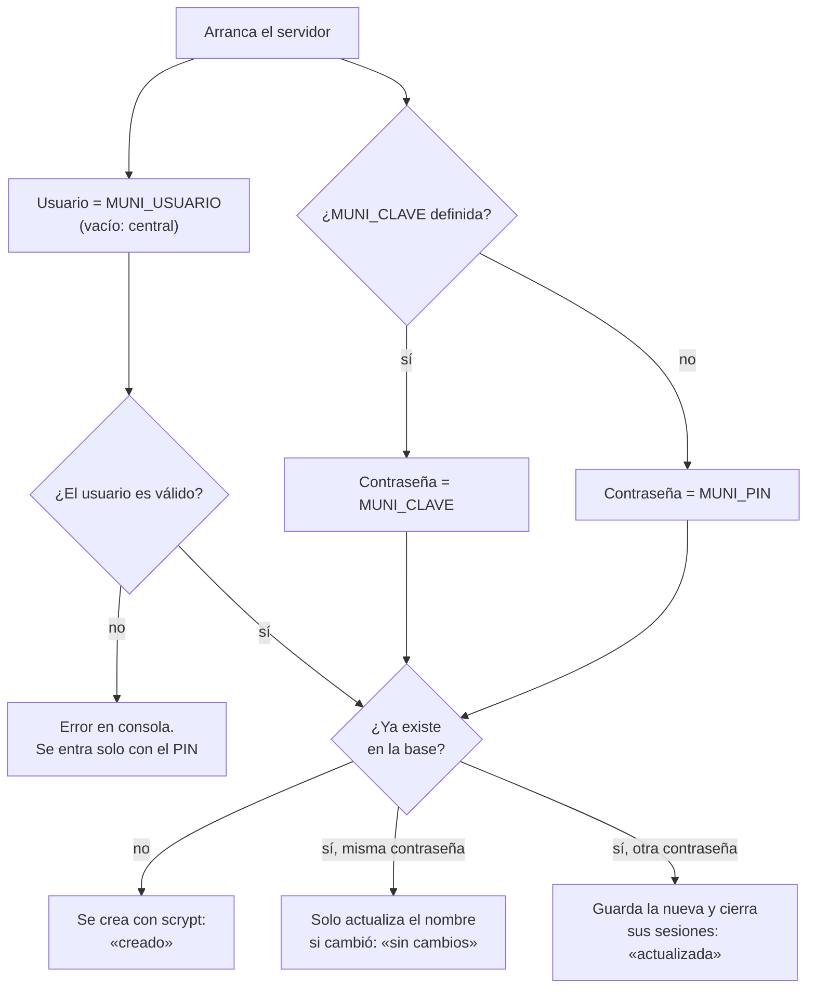
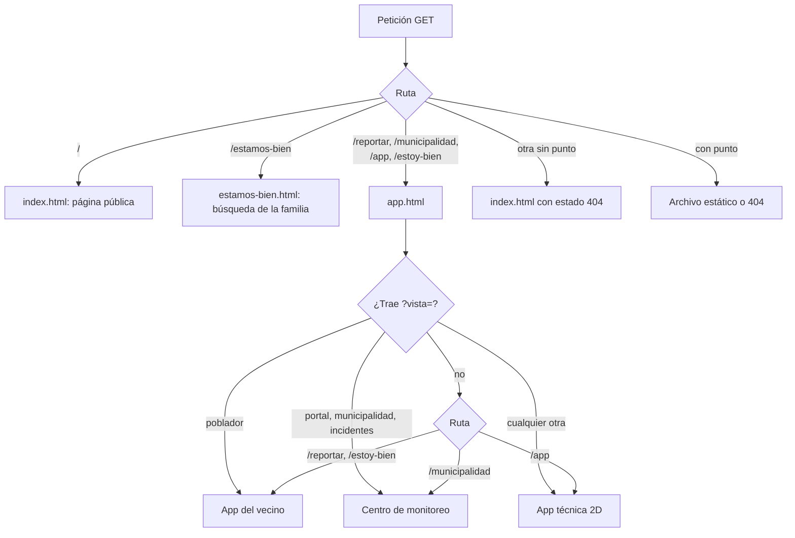

# Configuración

Dónde se cambia cada cosa en Yaku: las variables del servidor, las variables de compilación de la PWA, los parámetros de la URL y los textos de producto. Las plantillas están en `yaku.env.ejemplo` y `docker-compose.yml`.

## Camino rápido

- **Producción en Dokploy:** define `MUNI_PIN` (obligatoria) y, si quieres, `MUNI_CLAVE` en la pestaña *Environment*. El resto tiene valores por defecto.
- **Local:** `MUNI_PIN=… npm run servidor` (ver [Primeros pasos](PRIMEROS_PASOS.md)).
- **Nunca** subas un `.env` ni valores reales al repositorio. `.gitignore` ignora `.env` y `.env.*`.

## Variables del servidor

Las lee `servidor-local/servidor.ts`. Una variable **vacía cuenta como no definida**: Dokploy pasa las que no tienen valor como cadena vacía.

| Variable | Por defecto | Qué hace |
| --- | --- | --- |
| `MUNI_PIN` | PIN temporal de 6 dígitos que se imprime en consola | **Obligatoria en producción** (el compose se detiene sin ella). Respaldo sin usuarios (`X-Muni-Pin`) y contraseña de `central` si no hay `MUNI_CLAVE`. Menos de 8 caracteres en producción da un aviso, pero funciona |
| `MUNI_CLAVE` | el valor de `MUNI_PIN` | **Secreta.** Contraseña del usuario de `/municipalidad`. Si cambia, se cierran las sesiones abiertas |
| `MUNI_USUARIO` | `central` | Usuario del Centro de monitoreo. Se pasa a minúsculas; 3 a 32 caracteres entre letras minúsculas, números, `.`, `_` y `-` |
| `MUNI_NOMBRE` | `Municipio central` | Nombre que se muestra y que queda en el historial |
| `YAKU_SESION_HORAS` | `72` | Duración de la sesión guardada en el navegador. Mínimo 1 |
| `YAKU_MODO_ESTRICTO` | `0` | Solo el valor exacto `1` activa las protecciones extra. Ver [Seguridad](SEGURIDAD.md#mvp-frente-a-estricto) |
| `YAKU_REGLAS` | — | JSON parcial que reemplaza cifras de agrupación y respaldo. Ver [Agrupación y respaldo](AGRUPACION_Y_RESPALDO.md#ajustar-las-reglas) |
| `PORT` | `8080` | Puerto de escucha. La imagen lo fija en 8080 |
| `HOST` | `0.0.0.0` | Interfaz de escucha |
| `YAKU_DIST` | `dist` | Carpeta de la PWA compilada. La imagen usa `/app/dist` |
| `YAKU_DATOS` | `servidor-local/datos` | Carpeta de la base, las fotos y la clave de avisos. La imagen usa `/datos` |
| `NODE_ENV` | — | Con `production`, el servidor avisa si `MUNI_PIN` es corto. La imagen lo fija |
| `YAKU_MEMORIA` | — (apagado) | Solo el valor exacto `atomicmemory` activa las notas de zona del Centro de monitoreo. Ver [Notas de zona](#notas-de-zona-atomic-memory) |
| `ATOMICMEMORY_API_URL` | — | URL de Atomic Memory. Debe ser `https://`; `http://` solo en `127.0.0.1`, `localhost` o `[::1]` |
| `ATOMICMEMORY_API_KEY` | — | **Secreta.** Clave de Atomic Memory. Solo la usa el servidor; nunca llega al navegador |
| `YAKU_MEMORIA_TIMEOUT_MS` | `2500` | Límite de cada llamada a Atomic Memory, entre 500 y 10000 ms |

**Qué pasa el compose.** `docker-compose.yml` reenvía `MUNI_PIN`, `MUNI_USUARIO`, `MUNI_CLAVE`, `MUNI_NOMBRE`, `YAKU_SESION_HORAS`, `YAKU_MODO_ESTRICTO` y las cuatro variables de notas de zona, y fija `PORT=8080` y `YAKU_DATOS=/datos`. **`YAKU_REGLAS` no está en el compose**: para usarla en Dokploy hay que agregarla a `environment`.

### Cómo se resuelve el usuario municipal

El PIN sigue sirviendo siempre como credencial de respaldo (`X-Muni-Pin`), aunque haya usuario y contraseña distintos.

### Notas de zona (Atomic Memory)

Opcional y apagado por defecto. Con `YAKU_MEMORIA=atomicmemory`, `ATOMICMEMORY_API_URL` y `ATOMICMEMORY_API_KEY`, el detalle de un incidente muestra la sección «Notas de zona»: el operador guarda una nota corta (3 a 280 caracteres) sobre la zona, la vuelve a ver al abrir otro incidente de esa zona y puede corregirla o borrarla.

- **Zona**: el centro poblado más cercano al incidente (≤ 3 km) o, si no hay, la celda de ~1 km (`Cerca de -5.19, -80.63`).
- **De quién son**: del usuario de la sesión (`yaku-operador:<usuario>` en Atomic Memory). Con el PIN compartido no hay notas (403 `memoria_sin_usuario`). El servidor ignora cualquier `user_id` que mande el navegador.
- **Qué no hacen**: no cambian el respaldo, el estado, el historial ni los avisos del incidente. SQLite sigue siendo la fuente de verdad.
- **Si falla**: con Atomic Memory caído, lento (más de `YAKU_MEMORIA_TIMEOUT_MS`) o con una respuesta inesperada, la API responde 502 y la pantalla dice que la nota **no** se guardó o **no** se borró. Una nota solo cuenta como guardada si Atomic Memory devuelve su id, y como borrada si responde `success: true`.
- **Configuración incompleta** (falta URL o clave, URL no válida o `http://` fuera de este equipo): el servidor avisa en la consola, arranca igual y la sección no aparece.

Para probar sin el servicio real hay un fixture local (`node servidor-local/memoria-fixture.ts`, puerto 4604, clave `fixture-local`) que imita las tres rutas que se usan. **No es Atomic Memory**: guarda en la memoria del proceso y no va en la imagen.

## Variables de compilación (PWA)

Se leen al ejecutar `vite build` o `vite`. En la imagen Docker se compila con los valores por defecto.

| Variable | Por defecto | Qué hace |
| --- | --- | --- |
| `VITE_PHASE` | `3` | Entrega por partes. `1`: mapa base z11. `2`: suma el escenario CENEPRED y «Sin ubicar». `3`: suma OSIPTEL y `?basemap=z12` |
| `YAKU_API` | — | Solo en `dev` y `preview`. Con `produccion`, `/api` va a `https://yaku-relay-proto.pages.dev` en **solo lectura** |
| `YAKU_API_LOCAL` | `http://localhost:8080` | Solo en `dev` y `preview`. A dónde va `/api` por defecto |

En producción `/api` es del mismo origen y el proxy no existe.

### Variables de los scripts

Solo para quien corre pruebas o prepara datos (detalle en [Pruebas](PRUEBAS.md)):

| Variable | Script | Para qué |
| --- | --- | --- |
| `PORT_E2E` | E2E contra el servidor local | Puerto de la prueba (cada E2E tiene el suyo) |
| `CHROME`, `HEADLESS`, `VIEWPORT`, `VIDEO` | E2E | Ruta de Chrome, ver el navegador, tamaño, grabar |
| `BASE_URL` | `e2e.mjs`, `basemap-measure.mjs` | Probar contra una URL remota |
| `YAKU_USUARIO`, `YAKU_CLAVE` | `qa-produccion.mjs` | Usuario y contraseña para probar la sesión. **Nunca** al repositorio |
| `NGROK_DOMAIN`, `MANTENER` | `https-ngrok.mjs` | Dominio fijo y dejar abierto |
| `DATA_DIR` | `prep-data.mjs` | Carpeta de los insumos originales |
| `KV_NS` | `upload-basemap.mjs` | Espacio de KV de Cloudflare |

## Parámetros de la URL

| Parámetro | Valores | Dónde | Qué hace |
| --- | --- | --- | --- |
| `region` | `piura`, `lima` | Todas las pantallas con mapa | Elige la región y la recuerda en el equipo |
| `centro` | `lon,lat[,zoom]` | Todas las pantallas con mapa | Mueve la vista inicial |
| `basemap` | `z11`, `lima`, `z12` | Todas las pantallas con mapa | Elige otro mapa base de la tabla de `src/basemap-config.ts` |
| `vista` | `poblador`, `portal`, `municipalidad`, `incidentes`, `2d`, `3d`, `portal-relevo` | `app.html` | Fuerza la pantalla. Los enlaces viejos `/?vista=…` se redirigen a la ruta nueva |
| `nombre` | texto de 3 letras o más | `/estamos-bien` | Busca solo al abrirse; el enlace se puede compartir |

### Qué pantalla abre cada ruta

Las rutas viven en `src/rutas.ts` y las usan el servidor (`estaticos.ts`), el Worker y el plugin de Vite.

- `/reportar/` con barra final redirige a `/reportar` (con barra fallan las rutas relativas).
- Un enlace viejo en la raíz con `?vista=` se redirige con 302: `poblador` a `/reportar`; `municipalidad` o `incidentes` a `/municipalidad`; `portal` a `/municipalidad?vista=portal` (abre la pestaña Escenario); el resto, a `/app`. Un `/#p=…` va a `/app#p=…`.
- Dentro de `app.html` **sin ruta conocida** (por ejemplo `/app.html` directo): celular → vecino, escritorio → Centro de monitoreo, navegador automatizado → app técnica.
- Sin red, el service worker solo responde con `app.html` en `/reportar`, `/municipalidad` y `/app`; la raíz sale del precache de `index.html`.

## Dónde viven el escenario y los textos de producto

| Qué | Archivo |
| --- | --- |
| Escenario oficial (capas, fuente, fecha, advertencia) | `src/layers.ts` y `public/data/` |
| Regiones: encuadre, vista 3D, chip y descripción | `src/region.ts` |
| Mapas base y su sha256 | `src/basemap-config.ts` |
| Relieve DEM | `src/vista3d/config.ts` |
| Textos del vecino: rótulo «Reporte vecinal · por validar», pie legal, estados, acciones, mensajes | `src/poblador/textos.ts` (fuente única; el panel de la municipalidad la reutiliza) |
| Textos propios del panel de la municipalidad | `src/vista3d/municipalidad/textos.ts` |
| Tipos de incidente y su orden en el QR | `src/codec.ts` (`OBS_TYPES`, `OBS_LABELS`) y `src/poblador/tipos.ts` (botones) |
| Cifras de agrupación y respaldo | `servidor-local/reglas.ts` |
| Texto de la página pública | `src/landing/contenido.ts` |

Reglas de redacción que `textos.ts` deja escritas: un reporte vecinal **nunca es una alerta oficial**; al vecino se le muestra el nivel en palabras y nunca el número; nunca en rojo; «coinciden», no «confirman»; «asignado», nunca «en camino».

## Documentos relacionados

- [Despliegue](DESPLIEGUE.md): las variables en Dokploy.
- [Seguridad](SEGURIDAD.md): qué cambia en modo estricto.
- [Primeros pasos](PRIMEROS_PASOS.md): variables para correr en local.
