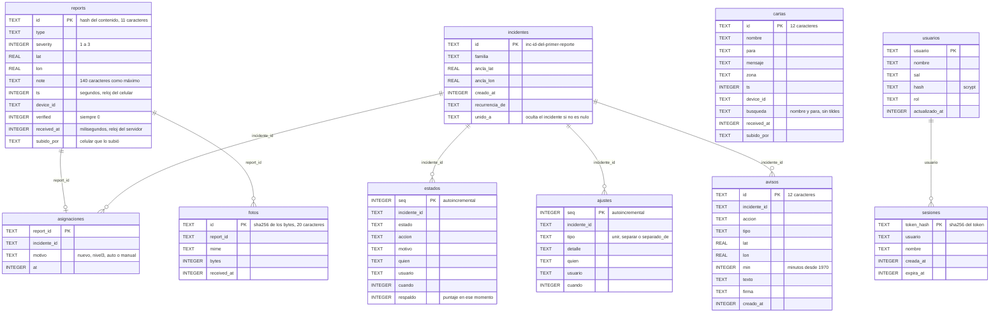
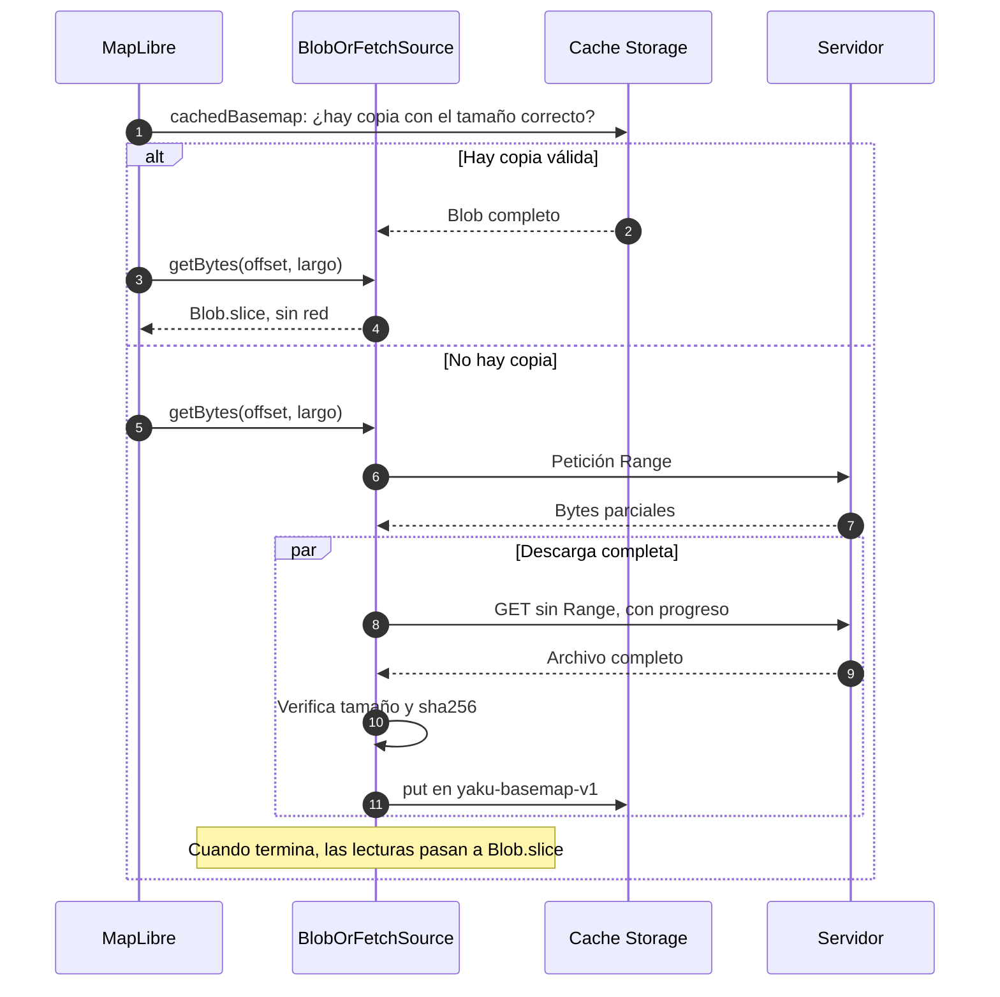

# Datos

Yaku guarda datos en tres sitios: la base **SQLite del servidor**, las bases **IndexedDB de cada celular** y el **mapa sin red** en Cache Storage. Este documento describe cada uno, qué es inmutable, cómo respaldar el volumen y de dónde sale cada capa oficial.

## Camino rápido

- ¿Quieres saber qué se guarda en el servidor? Ve al [diagrama entidad-relación](#sqlite-del-servidor).
- ¿Vas a respaldar el volumen? Salta a [cómo respaldar](#cómo-respaldar-el-volumen).
- ¿Qué lleva el celular? [IndexedDB](#indexeddb-en-el-celular).
- ¿Por qué el mapa funciona sin internet? [Mapa sin red](#mapa-sin-red).

## SQLite del servidor

Un solo archivo, `/datos/yaku.db` (en local, `servidor-local/datos/yaku.db`), abierto con `node:sqlite` en modo **WAL** (`journal_mode = WAL`, `synchronous = NORMAL`). El esquema lo crea `Almacen` al arrancar con `CREATE TABLE IF NOT EXISTS`, así que arrancar sobre una base vacía o ya existente funciona igual. No hay claves foráneas declaradas: las relaciones de abajo son lógicas.



### Índices

| Índice | Tabla y columnas | Para qué |
| --- | --- | --- |
| `reports_received` | `reports(received_at)` | El histórico por fecha de llegada |
| `asig_inc` | `asignaciones(incidente_id)` | Los miembros de un incidente |
| `estados_inc` | `estados(incidente_id, seq)` | El estado actual es la última fila |
| `fotos_rep` | `fotos(report_id)` | Fotos de un reporte y la cuota por reporte |
| `avisos_creado` | `avisos(creado_at)` | `GET /api/avisos` |
| `cartas_ts` | `cartas(ts)` | Las más recientes |
| `sesiones_expira` | `sesiones(expira_at)` | Limpiar sesiones vencidas |

### Migraciones

No hay un número de versión: cada arranque revisa las columnas con `PRAGMA table_info` y agrega las que falten con `ALTER TABLE`.

| Columna agregada | Tabla | Para qué |
| --- | --- | --- |
| `subido_por` | `reports` | Saber qué reportes llegaron por la cadena QR |
| `usuario` | `estados` y `ajustes` | Guardar quién (usuario de sesión o `pin`) junto al nombre que manda el cliente |

Luego `asignarPendientes` asigna a un incidente cualquier reporte que aún no tenga uno, por si el servidor se detuvo a medio camino.

### Qué es inmutable

| Tabla | Cómo se escribe | ¿Se modifica o borra? |
| --- | --- | --- |
| `reports` | `INSERT OR IGNORE` por id | **Nunca**: los reportes crudos no se borran |
| `estados` | Solo `INSERT` | No. El estado actual es la última fila |
| `ajustes` | Solo `INSERT` | No |
| `fotos` | `INSERT OR IGNORE` | No (el archivo también se guarda una vez) |
| `avisos` | `INSERT OR IGNORE` | No |
| `cartas` | `INSERT OR IGNORE` | No |
| `incidentes` | `INSERT`; `unido_a` cambia al unir | Solo ese campo |
| `asignaciones` | `INSERT OR REPLACE`; `UPDATE` al unir o separar | Sí: es lo que el operador corrige |
| `usuarios` | Upsert al arrancar | Sí, si cambia la contraseña o el nombre |
| `sesiones` | `INSERT`; `DELETE` al salir o al vencer | Sí |

Por eso corregir un incidente nunca pierde información: se mueven asignaciones, y cada ajuste queda en `ajustes`.

### Los dos relojes

| Reloj | Dónde | Unidad | Quién lo escribe |
| --- | --- | --- | --- |
| `ts` | `reports`, `cartas` | **segundos** | El celular. Puede estar mal puesto |
| `received_at` | `reports`, `fotos`, `cartas` | **milisegundos** | El servidor, al recibir |
| `cuando`, `creado_at`, `at`, `creada_at`, `expira_at` | El resto | milisegundos | El servidor |
| `min` | `avisos` | minutos desde 1970 | El servidor (es lo que se firma) |

Para agrupar se usa la [hora efectiva](AGRUPACION_Y_RESPALDO.md#hora-efectiva): el `ts` del celular salvo que venga más de 10 minutos en el futuro. El histórico del Centro de monitoreo se ordena por `received_at`, que el celular no puede falsear.

### Otros archivos del volumen

| Ruta | Contenido |
| --- | --- |
| `/datos/yaku.db`, `yaku.db-wal`, `yaku.db-shm` | La base y su registro WAL |
| `/datos/fotos/<id>.<jpg\|png\|webp>` | Una foto por archivo; la tabla `fotos` solo guarda metadatos |
| `/datos/avisos-clave.json` | Clave privada ECDSA P-256 (JWK), con permisos `0600`. **Es un secreto** |

### Cómo respaldar el volumen

No copies solo `yaku.db` con la base abierta: parte de los datos puede estar todavía en el archivo `-wal`. Pide a SQLite una copia consistente con `VACUUM INTO` **dentro del contenedor**:

```bash
docker compose exec yaku node -e "
const { DatabaseSync } = require('node:sqlite');
new DatabaseSync('/datos/yaku.db').exec(\"VACUUM INTO '/datos/respaldo.db'\");"
docker compose cp yaku:/datos/respaldo.db ./respaldo.db
docker compose cp yaku:/datos/fotos ./respaldo-fotos
docker compose cp yaku:/datos/avisos-clave.json ./respaldo-avisos-clave.json
docker compose exec yaku rm /datos/respaldo.db
```

- Guarda `avisos-clave.json` **aparte y protegido**: si se pierde, el servidor genera otra clave y los avisos firmados con la anterior dejan de verificarse en cuanto los celulares bajen la clave nueva.
- Para restaurar, detén el servicio, copia `respaldo.db` como `/datos/yaku.db` (sin los archivos `-wal` y `-shm` viejos), restaura `fotos/` y `avisos-clave.json`, y arranca.
- En Dokploy, el mismo comando se corre desde la terminal del contenedor del servicio `yaku`.

## IndexedDB en el celular

Dos bases independientes, ambas con la librería `idb`.

### `yaku-relay-proto` (versión 1, `src/db.ts`)

| Almacén | Clave | Contenido |
| --- | --- | --- |
| `obs` | `id` (índice `synced`) | Cada reporte, propio o recibido: los campos de la `Observation` más `source` (`local`, `qr`, `enlace` o `imagen`), `receivedAt`, `synced` y `syncedAt` |

`putIfAbsent` agrega solo si el id no existe. `markSynced` marca los que el servidor aceptó.

### `yaku-poblador` (versión 3, `src/poblador/almacen.ts`)

| Almacén | Versión | Clave | Contenido |
| --- | :---: | --- | --- |
| `fotos` | 1 | `id` (el del reporte) | `blob`, `bytes`, `w`, `h`, `subida`, `subidaAt` |
| `estados` | 1 | `id` (el del reporte) | `estado`, `accion`, `motivo`, `at`, `personas`. Gana el más reciente |
| `avisos` | 2 | `id` | El aviso firmado más `verificado`, `via` (`red` o `qr`) y `recibidoAt` |
| `cartas` | 3 | `id` | La carta más `via` (`local`, `qr` o `red`), `synced` y `recibidoAt` |

Un aviso que llegó sin poder verificarse se guarda; cuando el celular tiene red y la clave, `guardarAvisos` lo actualiza a verificado.

### `localStorage`

| Clave | Para qué |
| --- | --- |
| `yaku-device` | Código anónimo de 8 caracteres de este celular (`deviceId`). No es teléfono ni nombre |
| `yaku-avisos-clave` | Clave pública de la municipalidad, guardada la última vez que hubo red |
| `yaku-region` | Región elegida (`piura` o `lima`) |
| `yaku-bien-nombre` | El nombre que se escribió la última vez en «Estoy bien» |
| `yaku-muni-sesion` | Token de sesión del Centro de monitoreo (solo en el equipo de la municipalidad) |

## Mapa sin red

El mapa base **no** va en el precache del service worker (pesa megabytes): se guarda aparte, completo y con progreso visible, la primera vez que hay red.

| Archivo en `public/basemap/` | Bytes | Cuándo se usa |
| --- | ---: | --- |
| `piura_basemap_z11.5e31b1dc.pmtiles` | 2 594 101 | Predeterminado (Piura, hasta zoom 11) |
| `piura_basemap_z12.cc6d9219.pmtiles` | 5 740 095 | Con `?basemap=z12` (activo con `VITE_PHASE` 3 o más, que es el valor por defecto) |
| `lima_basemap_z15.c2041e0d.pmtiles` | 21 181 493 | Con `?region=lima`, con edificios |
| `piura_dem_z9.00100654.pmtiles` | 2 924 589 | Relieve 3D de Piura (Terrarium, zoom 5 a 9) |
| `fonts/` y `sprites/` | unos 0,9 MB en total | Van en el precache del service worker |

El nombre lleva los 8 primeros caracteres del sha256: un archivo nuevo es otro nombre y invalida la copia guardada. Fuente, licencia ODbL y atribución en `data/basemap/LICENSE_BASEMAP.md`.



- El mapa base se guarda en `yaku-basemap-v1`, el relieve en `yaku-dem-v1` y las fotos de la página pública en `yaku-imagenes` (hasta 60 entradas).
- Si la copia tiene otro tamaño, se borra y se vuelve a descargar. `pruneBasemaps` borra las copias de builds anteriores.
- Los videos de la página pública (`.mp4`, `.webm`) nunca se guardan: van siempre por red.

## Capas oficiales

Viven en `public/data/` y sí van en el precache. Sus metadatos (fuente, fecha, advertencia) están en `src/layers.ts` y se ven en la leyenda.

| Capa | Archivo | Bytes | Fuente | Script |
| --- | --- | ---: | --- | --- |
| Límite departamental de Piura | `piura-limite.geojson` | 9 635 | INDECI | `npm run prep:data` |
| Aviso de activación de quebradas | `senamhi-quebradas.geojson` | 20 273 | SENAMHI, vía geoservicio de INDECI | `npm run prep:data` |
| Áreas expuestas a erosión | `sigrid-erosion.geojson` y `sigrid-erosion-pts.geojson` | 78 140 y 18 567 | SIGRID/CENEPRED, vía INDECI | `npm run prep:data` |
| Escenario CENEPRED/SIGRID 23077 (centros poblados con cobertura OSIPTEL) | `cenepred-ccpp.geojson` | 203 461 | CENEPRED/SIGRID, IGN y OSIPTEL | `node scripts/prep-cenepred.mjs` |
| Filas sin ubicación del escenario | `cenepred-sin-ubicar.json` | 27 554 | CENEPRED/SIGRID | `node scripts/prep-cenepred.mjs` |

Las capas CENEPRED son **escenarios de riesgo**, no daños observados. Los insumos originales (`data/raw`, los Excel y CSV) no están en el repositorio; los scripts documentan en su cabecera qué archivos esperan. La capa del escenario depende de `VITE_PHASE` 2 o más (por defecto es 3).

## Documentos relacionados

- [Arquitectura](ARQUITECTURA.md): quién es dueño de cada dato.
- [Agrupación y respaldo](AGRUPACION_Y_RESPALDO.md): cómo se llenan `incidentes`, `asignaciones` y `estados`.
- [Despliegue](DESPLIEGUE.md): el volumen `yaku-datos` y las actualizaciones.
- [Seguridad](SEGURIDAD.md): qué datos son sensibles.
