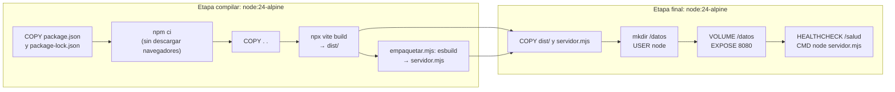
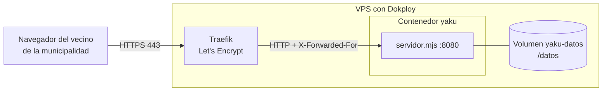
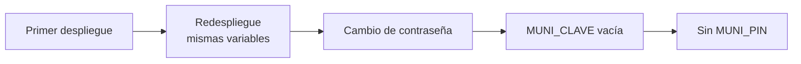

# Despliegue

Yaku se despliega como **una sola imagen Docker** (la PWA compilada más el servidor Node con SQLite) detrás del proxy de Dokploy. Esta guía cubre el paso a paso, cómo se construye la imagen, qué significa cada línea del log, cómo comprobar un despliegue y cómo actualizar sin perder datos. Al final, la alternativa en Cloudflare y sus límites.

## Camino rápido

Requisitos del VPS: unos **2 GB de RAM** para compilar la imagen (o swap).

1. **DNS.** Registros **A** de `yaku.lat` y `www.yaku.lat` a la IP del VPS. Si el DNS está en Cloudflare, en «DNS only».
2. **Servicio.** Dokploy → *Create Service* → **Compose** (tipo «Docker Compose», no «Stack») → este repositorio, rama `main`, archivo `./docker-compose.yml`.
3. **Environment.** Pega la plantilla de `yaku.env.ejemplo` y completa al menos `MUNI_PIN`. Todas las variables están en [Configuración](CONFIGURACION.md#variables-del-servidor).
4. **Domains.** Servicio `yaku`, host `yaku.lat`, **Container Port `8080`**, HTTPS con Let's Encrypt. Repite con `www.yaku.lat` si lo quieres.
5. **Deploy.** En los logs debe aparecer `Yaku servidor local en http://localhost:8080` y `Centro de monitoreo: usuario «central» (creado…`.
6. **Comprueba** con `npm run qa:produccion -- https://yaku.lat` (ver [más abajo](#qa-del-despliegue)).

El compose **no** trae Traefik ni publica puertos (`expose: 8080`): el proxy y el HTTPS los pone Dokploy.

## Cómo se construye la imagen

El `Dockerfile` tiene dos etapas, para que la imagen final no lleve `node_modules` ni código fuente.



- El servidor se empaqueta con esbuild en un solo archivo (`servidor.mjs`): incluye `src/codec.ts` y `pako`. **No hay dependencias en tiempo de ejecución.**
- La etapa final corre como usuario `node` (sin privilegios) y el compose agrega `no-new-privileges`.
- `ENV` de la imagen: `NODE_ENV=production`, `PORT=8080`, `HOST=0.0.0.0`, `YAKU_DIST=/app/dist`, `YAKU_DATOS=/datos`.
- `HEALTHCHECK` cada 30 s consulta `http://127.0.0.1:8080/salud`.
- `.dockerignore` deja fuera `node_modules`, `dist`, `results`, `docs`, `servidor-local/datos`, `servidor-local/salida`, `.git`, `.github`, los `.env`, los videos `.webm` y las bases `.db` y `.sqlite`.
- Los logs del contenedor rotan: `json-file`, 10 MB por archivo, 3 archivos.

## Topología en producción



- Traefik termina el HTTPS y reenvía a `yaku:8080` por la red interna de Docker.
- El servidor necesita la IP real para el modo estricto. Lee **el último salto** de `X-Forwarded-For` (el que agregó Traefik), y solo si quien conecta es una red privada (`10.`, `172.16–31.`, `192.168.`, `127.`, `fc00::/7`). Si alguien conecta directo desde internet, ese encabezado se ignora.
- El estado vive solo en el volumen `yaku-datos`: la base, las fotos y la clave de avisos. El contenedor se puede reconstruir cuando quieras.
- La cámara y el modo sin red necesitan HTTPS: otra razón para no abrir el puerto 8080 sin Traefik.

## Qué significa cada línea del log

| Línea | Significado |
| --- | --- |
| `Yaku servidor local en http://localhost:8080  (dist: /app/dist, datos: /datos)` | El servidor arrancó |
| `  Centro de monitoreo: usuario «central» (creado, …)` | Primer arranque: se creó el usuario |
| `  … (contraseña sin cambios, …)` | Redespliegue normal. Las sesiones siguen valiendo |
| `  … (contraseña actualizada: se cerraron sus sesiones, …)` | Cambió `MUNI_CLAVE` (o `MUNI_PIN` si no hay clave). Todos deben volver a entrar |
| `…, contraseña = MUNI_PIN).` | No hay `MUNI_CLAVE`: la contraseña es el PIN |
| `  MUNI_PIN definido por variable de entorno.` | Normal |
| `  MUNI_PIN no definido: PIN temporal de esta sesión = NNNNNN` | Falta `MUNI_PIN`. El compose normalmente lo impide; el PIN cambia en cada arranque |
| `Aviso: MUNI_PIN tiene menos de 8 caracteres…` | Funciona, pero conviene uno más largo |
| `YAKU_REGLAS no es JSON válido: se usan las reglas por defecto` | Revisa el JSON de `YAKU_REGLAS` |
| `MUNI_USUARIO: usuario inválido: … Se entra solo con el PIN.` | El usuario no cumple 3 a 32 caracteres `a-z 0-9 . _ -` |
| `  Ojo: no hay dist/index.html → corre «npm run build»` | La imagen no trae la PWA: revisa el build |
| `credencial incorrecta N veces desde <ip>: bloqueada 5 min` | Modo estricto: esa IP falló 10 veces. Si todas las IP salen iguales, revisa `X-Forwarded-For` |
| `error en <MÉTODO> <ruta> …` | Error interno en esa petición; el cliente recibe un 500 genérico |

## QA del despliegue

Dos scripts distintos, para dos momentos.

**Antes de desplegar: `npm run qa:despliegue`.** Simula lo que hace Dokploy sin necesitar el daemon de Docker: resuelve las variables con `docker compose config` (el compose más la pestaña Environment), arranca el **mismo servidor empaquetado** que corre la imagen, con el `ENV` del Dockerfile, sobre una carpeta que hace de volumen `yaku-datos`, y encadena despliegues:



Comprueba que el usuario se crea solo, que las sesiones y los datos sobreviven a cada redespliegue y que el compose se detiene sin `MUNI_PIN`. Usa datos de prueba y una carpeta temporal. Con `--sin-compilar` reutiliza `dist/` y el paquete si ya existen.

**Después de desplegar: `npm run qa:produccion -- https://yaku.lat`.** Revisa producción **sin escribir datos**: salud, rutas, API protegida y, si das la contraseña, el ciclo completo de sesión (entrar, recargar, cambiar de región, salir y comprobar que el token deja de servir). No necesita `npm install`. La contraseña va por variable de entorno, nunca en el repositorio:

```bash
YAKU_CLAVE='<contraseña>' node scripts/qa-produccion.mjs https://yaku.lat
```

```powershell
$env:YAKU_CLAVE = "<contraseña>"; node scripts/qa-produccion.mjs; Remove-Item Env:YAKU_CLAVE
```

El usuario por defecto es `central`; cámbialo con `YAKU_USUARIO`.

## Actualizar sin perder datos

1. Haz el cambio en `main` y pulsa **Deploy** (o activa el despliegue automático de Dokploy).
2. Dokploy reconstruye la imagen y reinicia el contenedor. El volumen `yaku-datos` se conserva: la base, las fotos y `avisos-clave.json` siguen ahí.
3. Al arrancar, el servidor agrega las columnas nuevas a la base si faltan (ver [migraciones](DATOS.md#migraciones)) y reasigna cualquier reporte sin incidente.
4. Las sesiones abiertas **siguen valiendo**, salvo que hayas cambiado `MUNI_CLAVE`.
5. Los celulares reciben la PWA nueva sola (el service worker usa `autoUpdate`).

Antes de un cambio grande, haz una [copia con `VACUUM INTO`](DATOS.md#cómo-respaldar-el-volumen). **No borres el volumen**: es la base de los reportes, y `avisos-clave.json` es lo que da validez a los avisos ya emitidos.

## Alternativa: Cloudflare Pages

Existe una versión mínima sobre Cloudflare Pages.

```bash
npm run build && npm run build:worker
```

`scripts/build-worker.mjs` genera `deploy/_worker.js` (Pages en «modo avanzado», desde `server/worker.ts`) con toda la PWA embebida, y `deploy/deploy-code.js` para el conector de Cloudflare.

| Recurso | Binding | Para qué |
| --- | --- | --- |
| D1 | `DB` | Tabla `reports` |
| KV | `BASEMAP` | Los `.pmtiles`, partidos en trozos de 1 MiB, que se suben con `scripts/upload-basemap.mjs` |

Limitaciones:

- El Worker solo tiene `POST /api/sync`, `GET /api/stats` y `GET /api/reports`. **No hay** incidentes, estados, fotos, sesión, avisos firmados ni «Estoy bien». El Centro de monitoreo cae a solo lectura: sin `/api/incidentes` agrupa en el navegador lo que trae `/api/reports`. Ver la [comparación](API.md#diferencias-con-el-worker-de-cloudflare).
- `/api/reports` es público: no hay credenciales en el Worker.
- Los videos de la página pública (`.mp4`, `.webm`) no se embeben por el límite de tamaño: la página muestra sus pósters.
- El esquema de D1 no está en el repositorio. El Worker espera una tabla `reports` con las columnas `id`, `type`, `severity`, `lat`, `lon`, `note`, `ts`, `device_id`, `verified` y `received_at`.
- Producción (`yaku.lat`) corre la imagen Docker; el Worker es una alternativa.

## Documentos relacionados

- [Configuración](CONFIGURACION.md): las variables.
- [Datos](DATOS.md): el volumen y los respaldos.
- [Seguridad](SEGURIDAD.md): modo estricto y secretos.
- [Pruebas](PRUEBAS.md): qué corre la CI antes de llegar a `main`.
