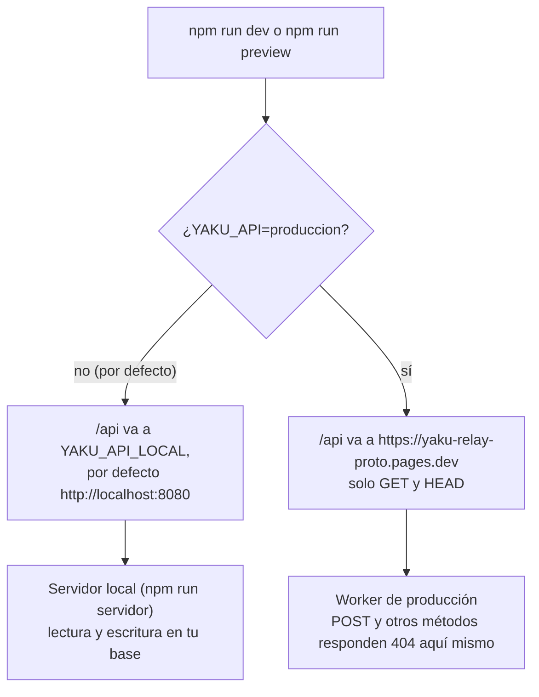

# Primeros pasos

Esta guía te lleva de un repositorio recién clonado a Yaku funcionando en tu máquina: el servidor con SQLite, la app del vecino y el Centro de monitoreo. Después explica cómo probarlo con celulares reales en modo avión.

## Requisitos

| Qué | Versión | Nota |
| --- | --- | --- |
| Node.js | 24 recomendada (`.nvmrc`), 22.18 como mínimo | El servidor usa `node:sqlite` |
| npm | El que trae Node | Se instala con `npm ci` |
| Chrome | Reciente | Solo para los E2E y para probar la cámara |
| Docker y Compose v2 | Opcional | Solo para probar la imagen igual que en producción |
| ngrok | Opcional | Solo para probar con celulares (HTTPS) |

## Camino rápido

Compila la PWA, empaqueta el servidor y lo arranca, todo en un comando (`npm run servidor`).

En bash:

```bash
npm ci
MUNI_PIN=un-pin-largo PORT=8787 npm run servidor
```

En PowerShell:

```powershell
npm ci
$env:MUNI_PIN = "un-pin-largo"; $env:PORT = "8787"
npm run servidor
```

Sin `PORT` escucha en el 8080. Sin `MUNI_PIN` genera uno temporal de 6 dígitos y lo imprime.

### Qué debe salir en la consola

```text
Yaku servidor local en http://localhost:8787  (dist: …/dist, datos: …/servidor-local/datos)
  Centro de monitoreo: usuario «central» (creado, contraseña = MUNI_PIN).
  MUNI_PIN definido por variable de entorno.
```

- Si defines una `MUNI_CLAVE` distinta del PIN, la primera línea termina sin el `, contraseña = MUNI_PIN`.
- Al volver a arrancar sobre la misma base dice `(contraseña sin cambios)`; si cambiaste la contraseña, `(contraseña actualizada: se cerraron sus sesiones)`.
- Sin `MUNI_PIN`: `MUNI_PIN no definido: PIN temporal de esta sesión = 123456` (cada arranque cambia).
- Si falta `dist/index.html`: `Ojo: no hay dist/index.html → corre «npm run build» (la API funciona igual).`

### Verifica que funciona

Con el servidor en el puerto 8787:

| Qué abrir | Qué debes ver |
| --- | --- |
| `http://localhost:8787/salud` | `ok` |
| `http://localhost:8787/api/stats` | `{"total":0,"unique_ids":0,…,"servidor":"local"}` en una base nueva |
| `http://localhost:8787/` | La página pública |
| `http://localhost:8787/reportar` | La app del vecino. En escritorio puede pedir permiso de ubicación |
| `http://localhost:8787/municipalidad` | El acceso al Centro de monitoreo. Usuario `central`, contraseña `MUNI_PIN` |
| `http://localhost:8787/estamos-bien` | La búsqueda de la familia |

Prueba el ciclo completo: guarda un reporte en `/reportar`, entra a `/municipalidad`, valídalo y asigna una acción; vuelve a `/reportar` y toca «Actualizar estado».

Los datos quedan en `servidor-local/datos/` (la base `yaku.db`, `fotos/` y `avisos-clave.json`), que git ignora. Borra esa carpeta para empezar de cero.

## Modo desarrollo con proxy

Para editar la PWA con recarga en caliente:

```bash
npm run dev          # Vite en http://localhost:5173 (con --host: visible en tu red)
```

Vite no trae API: **reenvía `/api`**. A dónde, lo decide `YAKU_API`:



- Por defecto Vite espera al servidor en el puerto **8080**. Si arrancaste el servidor en otro puerto, dile a dónde: `YAKU_API_LOCAL=http://localhost:8787 npm run dev`.
- Con `YAKU_API=produccion` nada de lo que pruebes escribe en producción, porque cualquier método que no sea `GET` o `HEAD` se corta antes de salir de tu máquina. Ese destino es el Worker de Cloudflare, que solo tiene sync, stats y reports.
- `npm run servidor:dev` arranca solo el servidor, sin compilar la PWA, ejecutando TypeScript directo (Node 22.18 o más).

## Probar con celulares reales

La cámara (`getUserMedia`) y el service worker (el modo avión) exigen **HTTPS**; `localhost` basta en la misma máquina, pero un celular necesita un túnel. `scripts/https-ngrok.mjs` levanta el servidor local, abre un túnel ngrok y comprueba por el túnel `/salud`, la PWA, `sw.js`, el manifest y, en Chrome móvil, contexto seguro, cámara y service worker.

```bash
npm run build
node scripts/https-ngrok.mjs                  # prueba y cierra (deja results/https-ngrok.json)
MANTENER=1 node scripts/https-ngrok.mjs       # queda abierto para la demo (Ctrl+C cierra)
NGROK_DOMAIN=mi-dominio.ngrok-free.app MANTENER=1 node scripts/https-ngrok.mjs   # dominio fijo
```

Necesitas el CLI de `ngrok` en el PATH y su authtoken en la configuración de ngrok (el script no lo lee ni lo imprime). Imprime la URL y un QR en la terminal para abrirla en los celulares.

### Recorrido A/B en modo avión

1. Abre la URL con **internet** en los dos celulares (A y B), entra a `/reportar` y espera a que termine de guardarse el mapa. Instala la PWA si quieres.
2. Activa el **modo avión** en los dos.
3. En A, guarda un reporte (por ejemplo, casa dañada). En B, guarda otro de casa dañada a menos de 100 m.
4. En los dos, abre **Intercambiar** y pongan los celulares frente a frente hasta que ambos digan «Listo».
5. En B, desactiva el modo avión. La app sube sola la cadena (los reportes de ambos) y, cuando hay red, también las fotos.
6. En la computadora, entra a `/municipalidad`: debe aparecer **un** incidente con 2 vecinos. Valida y asigna «Bomberos».
7. B lo ve en 20 segundos o menos como «Bomberos asignados». A, que sigue sin red, lo recibe cuando intercambien otra vez con B.

`npm run ensayo:demo` automatiza este recorrido con dos celulares simulados.

## Regiones

El Centro de monitoreo trae dos regiones: **Piura** (escenario oficial con relieve) y **Lima** (prueba en sala con edificios en 3D).

- `?region=piura` o `?region=lima` elige la región y la recuerda en ese equipo.
- `?centro=lon,lat[,zoom]` mueve la vista inicial, por ejemplo `?region=lima&centro=-77.03,-12.12,15`.
- Cambiar de región recarga la página, porque cambia el mapa base. La sesión se conserva.

## Docker local

La imagen es la misma de producción. El `docker-compose.yml` solo hace `expose` del puerto 8080 y **no lo publica**, porque en Dokploy lo publica Traefik. Para verla en tu máquina, agrega un archivo `docker-compose.override.yml` junto al compose (no lo subas al repo):

```yaml
services:
  yaku:
    ports:
      - "8080:8080"
```

```bash
MUNI_PIN=un-pin-largo docker compose up --build
```

En PowerShell: `$env:MUNI_PIN = "un-pin-largo"; docker compose up --build`. Compose se detiene con `Define MUNI_PIN en Dokploy → Environment` si `MUNI_PIN` está vacío. Los datos quedan en el volumen `yaku-datos`.

## Problemas frecuentes

| Síntoma | Causa y arreglo |
| --- | --- |
| `Define MUNI_PIN en Dokploy → Environment` al hacer `docker compose up` | Falta `MUNI_PIN`. Defínelo en el entorno o en un `.env` junto al compose |
| `No se pudo abrir la cámara (… ¿falta HTTPS?)` en el celular | El celular abrió la app por `http://`. Usa el túnel HTTPS |
| El mapa no aparece sin red | El mapa se guarda la **primera** vez que hay internet. Abre `/reportar` una vez con red y espera a que termine |
| Vite muestra `ECONNREFUSED` en `/api/...` | El servidor local no está arriba o escucha en otro puerto. Revisa `YAKU_API_LOCAL` |
| El puerto ya está en uso | Cambia `PORT` |
| Error con `node:sqlite` | Node es más viejo que 22.13. Usa 24 |
| Olvidé la contraseña | Cambia `MUNI_CLAVE` (o `MUNI_PIN`) y reinicia: la contraseña se actualiza y se cierran las sesiones |
| `429` al entrar | Estás en modo estricto y fallaste 10 veces: espera 5 minutos |
| Un E2E no encuentra Chrome | Indica su ruta con la variable `CHROME` |

## Documentos relacionados

- [Configuración](CONFIGURACION.md): todas las variables y parámetros de URL.
- [Pruebas](PRUEBAS.md): lo que corre la CI y los E2E.
- [Despliegue](DESPLIEGUE.md): llevarlo a Dokploy.
