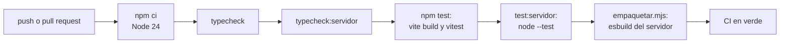

# Pruebas

Qué verifica Yaku, con qué herramienta y cómo correrlo. La regla práctica: lo que corre la CI en cada `push` y `pull_request` es lo mínimo para integrar; los E2E con Chrome y los QA de despliegue se corren a mano antes de una demo o de un cambio grande.

## Camino rápido

Es lo mismo que corre `.github/workflows/ci.yml` (Node 24, `npm ci` antes):

```bash
npm ci
npm run typecheck             # tsc: src, tests, scripts y server
npm run typecheck:servidor    # tsc -p servidor-local
npm test                      # vite build + vitest run
npm run test:servidor         # node --test servidor-local/pruebas/*.test.ts
node servidor-local/empaquetar.mjs   # el servidor se puede empaquetar
```



## Capas de prueba

| Capa | Herramienta | Dónde | Qué comprueba | Cuándo |
| --- | --- | --- | --- | --- |
| Tipos | `tsc` | `tsconfig.json` y `servidor-local/tsconfig.json` | Que todo compile con `strict` | CI |
| Pruebas de la PWA | Vitest (entorno `node`) | `tests/*.test.ts` | Codec, QR, almacenes, textos, rutas, pantallas sin DOM, Worker, bundle | CI (`npm test`) |
| Pruebas del servidor | `node --test` | `servidor-local/pruebas/*.test.ts` | API, agrupación, SQLite, sesión, avisos, «Estoy bien», seguridad | CI (`npm run test:servidor`) |
| E2E | Playwright con Chrome local | `scripts/e2e*.mjs`, `scripts/ensayo-demo.mjs` | Flujos reales en navegador contra el servidor real | A mano |
| QA de despliegue | Scripts de Node | `scripts/qa-despliegue.mjs`, `scripts/qa-produccion.mjs` | Variables, redespliegues, sesión en producción | Antes y después de desplegar |

`npm test` **compila antes** (`vite build`) porque `tests/bundle.test.ts` revisa el `dist/` resultante: textos prohibidos y etiquetado de reportes.

### Pruebas de la PWA (`tests/`)

| Archivo | Qué prueba |
| --- | --- |
| `codec.test.ts` | Formato YR1: ids, CRC32, base45, fragmentos, `Reassembler`, enlace `#p=` |
| `scanner.test.ts` | Lectura de QR con cuadros de cámara **simulados** (`tests/qr-camara-sim.ts`) a 1280×720 y 1920×1080 |
| `db.test.ts` | IndexedDB con `fake-indexeddb`: dedup y marcas de sincronización |
| `poblador.test.ts` | Tipos ↔ codec, estado de vuelta (servidor y `YE1`), vecinos que coinciden, foto, textos |
| `avisos.test.ts` | Aviso firmado: forma, firma y relevo por `YA1` |
| `cartas.test.ts` | «Estoy bien»: ids, límites, `YB1`, búsqueda |
| `estamos-bien.test.ts` | Piezas de la página de la familia |
| `basemap.test.ts` | Mapa base: lectura desde Blob sin red, descarga verificada, guardado |
| `region.test.ts` | Piura y Lima, `?region=`, `?centro=` |
| `auth-rutas.test.ts` | Rutas y redirecciones de `src/rutas.ts` |
| `auth-sesion.test.ts` | Acceso del Centro de monitoreo: sesión y PIN de respaldo |
| `worker.test.ts` | `server/worker.ts` con un D1 falso en memoria |
| `bundle.test.ts` | El `dist/` ya compilado |
| `vista3d*.test.ts` | La vista 3D y el Centro de monitoreo sin DOM: cámara, modo claro y oscuro, monitoreo, municipalidad, portal, red, temas |

### Pruebas del servidor (`servidor-local/pruebas/`)

Usan SQLite real en una carpeta temporal fuera del repo o `:memory:`.

| Archivo | Qué prueba |
| --- | --- |
| `agrupacion.test.ts` | Agrupación y respaldo: los 7 casos mínimos y los ejemplos calculados |
| `almacen.test.ts` | Esos mismos casos por el camino real (SQLite, asignación al llegar), foto pendiente, descarte y prioridad |
| `api.test.ts` | `/api/sync` (mismo contrato que el Worker), la historia de la demo en `/api/incidentes`, unir y separar |
| `cadena.test.ts` | La prueba de dos celulares: uno sin red pasa por QR sus reportes y el otro los sube; la municipalidad ve qué llegó por la cadena |
| `avisos.test.ts` | Avisos firmados al asignar y atender |
| `cartas.test.ts` | «Estoy bien»: subida idempotente y búsqueda sin tildes |
| `sesion.test.ts` | Usuario con scrypt, token, vencimiento a las 72 h, «Salir», cambio de contraseña, PIN de respaldo |
| `seguridad.test.ts` | Modo MVP y modo estricto: bloqueo por intentos, histórico privado, CORS, cuotas de fotos, límite por IP |
| `http.test.ts` | El servidor HTTP real en un puerto libre |
| `arranque-env.test.ts` | Variables vacías como las pasa Dokploy: el servidor arranca igual |

Para correr uno solo: `node --test servidor-local/pruebas/agrupacion.test.ts`.

## E2E con Chrome

Requieren Chrome local (la ruta se puede dar en `CHROME`) y dejan capturas en `docs/` y mediciones en `results/`, que git ignora. Cada uno usa un puerto propio (`PORT_E2E`).

| Comando | Qué prueba |
| --- | --- |
| `npm run ensayo:demo` | La demo de 3 min completa, en 6 pasos y con tiempos: reporte sin red, relevo QR, validación, aviso firmado de vuelta por QR, «Estoy bien» |
| `npm run e2e:poblador` | Dos celulares A ↔ B con el `/api` **simulado** en el navegador |
| `npm run e2e:poblador:real` | Lo mismo contra el servidor real (SQLite temporal) |
| `npm run e2e:envio` | Con internet, el reporte llega al servidor en menos de 3 s aunque la foto anterior siga subiendo |
| `npm run e2e:monitoreo` | Centro de monitoreo: acceso, 2 reportes cercanos = 1 incidente, Validar y «Bomberos», vuelve al vecino por `/api/estado` |
| `npm run e2e:lima` | Región Lima: mapa de z15, edificios 3D, sin relieve, selector Piura/Lima |
| `npm run e2e:sesion` | La sesión sobrevive a recargar y a cambiar de región; «Salir» la cierra |
| `npm run e2e:estamos-bien` | La familia, desde otro huso horario, busca el mensaje por nombre |
| `npm run e2e:rutas` | Rutas, redirecciones y cada pantalla abriendo desde caché en modo avión |
| `npm run e2e:landing` | Página pública: CTAs, sin peticiones externas, imágenes con alt, LCP y CLS |
| `npm run e2e`, `e2e:desktop` | E2E general de la PWA con viewport Android o de escritorio: local con `vite preview` o remoto con `BASE_URL` |
| `npm run e2e:3d`, `e2e:3d-vista`, `e2e:portal` | Vista 3D, relieve, uso sin red |
| `npm run e2e:incidentes`, `e2e:municipalidad` | Alias del E2E del monitoreo |

### Cómo se simula la cámara

Dos celulares en una sola máquina no pueden mirarse. Los E2E reemplazan `navigator.mediaDevices.getUserMedia` por un `canvas.captureStream(15)`: cada celular simulado "ve" un canvas donde la prueba dibuja el QR que muestra el otro. El código real de `src/scanner.ts` lee ese video como si fuera una cámara, así que se prueba también el reensamblado y el guardado. Las páginas se cargan con red y luego se cortan con `setOffline`.

`scripts/e2e-camara.ts` va más allá: usa un video con cuadros simulados (perspectiva, desenfoque, reflejo, moiré, ruido) y fuerza jsQR, la ruta más difícil, la de iPhone.

Limitación declarada en el ensayo: el arranque en frío **sin red** del service worker se prueba en `scripts/e2e.mjs` y a mano en el celular.

## Mediciones

| Comando | Qué mide |
| --- | --- |
| `npm run measure:qr` | Ida y vuelta real: registros → payload → PNG QR → jsQR → reensamblado (`results/qr-measure.json`) |
| `npx vite-node scripts/e2e-camara.ts` | Lectura de QR animado con cámara simulada (`results/e2e-camara.json`) |
| `node scripts/basemap-measure.mjs` | El guardado sin red del mapa base con perfiles de red 4G y 3G |
| `node scripts/https-ngrok.mjs` | HTTPS para celulares: salud, PWA, service worker y cámara por el túnel |

## Prueba manual de humo

Con el servidor corriendo ([Primeros pasos](PRIMEROS_PASOS.md)), en 5 minutos:

1. `/salud` responde `ok` y `/api/stats` responde JSON.
2. En `/reportar`, guarda un reporte con foto. Debe aparecer en «Mis reportes» y, con red, pasar a «Enviado».
3. En `/municipalidad`, entra con `central`. El reporte aparece como incidente «Reporte vecinal · por validar».
4. Valídalo y asigna una acción. En 20 segundos o menos, `/reportar` muestra el aviso firmado «… asignado» con «Firmado por la municipalidad ✓».
5. En «Intercambiar», se ve tu QR y la cámara pide permiso.
6. En «Estoy bien», guarda un mensaje y búscalo en `/estamos-bien`.
7. Pulsa «Salir» en el Centro de monitoreo y recarga: vuelve a pedir la contraseña.

## Antes de abrir un pull request

- [ ] `npm run typecheck && npm run typecheck:servidor`
- [ ] `npm test` y `npm run test:servidor`
- [ ] `node servidor-local/empaquetar.mjs`
- [ ] Si tocaste el codec, el formato de QR o `OBS_TYPES`: `tests/codec.test.ts`, `servidor-local/pruebas/cadena.test.ts` y [Relevo por QR](RELEVO_QR.md)
- [ ] Si tocaste reglas de agrupación: `servidor-local/pruebas/agrupacion.test.ts` y [Agrupación y respaldo](AGRUPACION_Y_RESPALDO.md)
- [ ] Si tocaste una pantalla: el E2E correspondiente de la tabla
- [ ] Si tocaste Docker, el compose o las variables: `npm run qa:despliegue`
- [ ] El mensaje de commit es Conventional Commits, en inglés, **sin** líneas `Co-Authored-By` ni `Generated with` de IA (lo rechaza `.githooks/commit-msg`; actívalo con `git config core.hooksPath .githooks`)
- [ ] Actualizaste los documentos que describen lo que cambiaste

## Documentos relacionados

- [Primeros pasos](PRIMEROS_PASOS.md): dejar el entorno listo.
- [Despliegue](DESPLIEGUE.md): `qa:despliegue` y `qa:produccion`.
- [Relevo por QR](RELEVO_QR.md): qué hace el lector que se simula.
