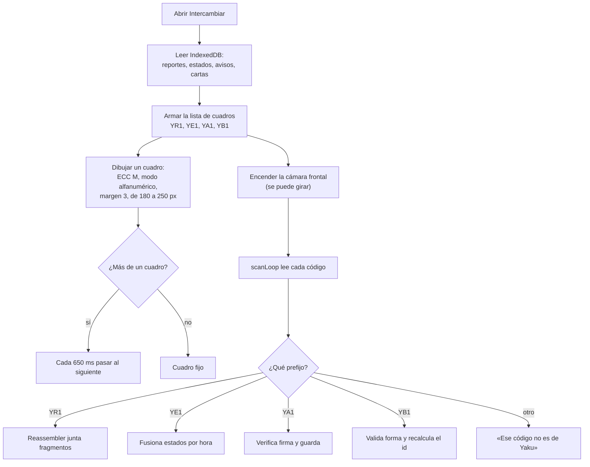
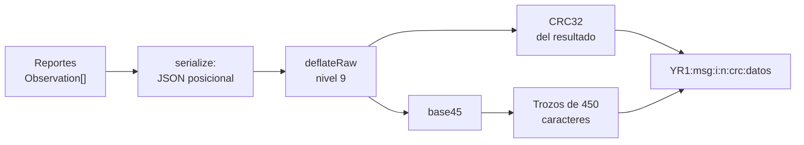

# Relevo por QR

El relevo por QR es lo que permite que un reporte llegue a la municipalidad aunque quien lo escribió nunca encuentre internet: otro vecino lo lleva en su celular y lo sube. Este documento describe qué viaja, cómo se empaqueta, cuánto pesa y por qué un código dañado o repetido no rompe nada.

Todo el formato vive en `src/codec.ts` (reportes, fragmentos, enlace) y en `src/poblador/` (`avisos.ts`, `estados.ts`, `cartas.ts`). La pantalla «Intercambiar» está en `src/poblador/app.ts` y la lectura de cámara en `src/scanner.ts`.

## Camino rápido

1. Dos vecinos abren **Intercambiar** y ponen los celulares frente a frente.
2. Cada celular muestra su QR animado (un cuadro nuevo cada **650 ms**) y su cámara lee el del otro.
3. Al terminar, los dos tienen los reportes de ambos, más los estados, avisos y mensajes «Estoy bien» que el otro llevaba.
4. El primero que encuentre internet sube todo (ver [sincronización](ARQUITECTURA.md#3-sincronización-con-internet)).

## Qué viaja y qué no

| Prefijo | Qué lleva | Límite por código | Vigencia | Se firma |
| --- | --- | --- | --- | --- |
| `YR1` | Reportes vecinales | Trozos de 450 caracteres base45, hasta 999 fragmentos | Sin vencimiento | No: el id es un hash del contenido |
| `YE1` | Estado de cada reporte que puso la municipalidad | 25 filas, un solo código | Sin vencimiento. Gana el más reciente | No |
| `YA1` | Aviso de la municipalidad | 1 aviso por código (unos 300 caracteres), hasta 5 códigos | 72 horas desde el minuto del aviso | **Sí**, ECDSA P-256 |
| `YB1` | Mensajes «Estoy bien» | Hasta 8 cartas en total, repartidas en códigos de 600 caracteres como máximo | 7 días desde la hora de la carta | No: el id es un hash del contenido |
| Fotos | **No viajan** | — | — | — |

Las fotos pesan de 50 a 200 veces más que 20 reportes. Las sube el celular que las tomó cuando tiene internet. En el reporte queda la marca `(con foto)` al final de la nota para que quien lo recibe sepa que existe.

## Ciclo de intercambio

Al abrir «Intercambiar», `abrirIntercambio()` arma la lista de cuadros en este orden:

1. Los fragmentos `YR1` de **todos** los reportes que hay en el celular, propios y recibidos.
2. Un código `YE1` con los estados que el celular conoce (si hay alguno).
3. Los códigos `YA1` de los avisos verificados de las últimas 72 horas, los más recientes primero, hasta 5.
4. Los códigos `YB1`: primero las cartas propias, luego las más recientes de la última semana.



- **Cámara frontal por defecto** (`facingMode: user`): los celulares quedan frente a frente y la frontal mira al otro. Hay un botón para girar a la trasera.
- **Modo alfanumérico y corrección M**: base45 usa el alfabeto del QR alfanumérico (5,5 bits por carácter), así el cuadro queda más liviano y se lee mejor. Un fragmento de 450 caracteres cae en una versión 11–12, según el comentario de `DEFAULT_CHUNK`.
- **Sin cámara o sin HTTPS**: la pantalla ofrece «Leer código desde una foto» (`decodeImageFile`, siempre con jsQR). La cámara y el servicio worker exigen HTTPS (ver [Primeros pasos](PRIMEROS_PASOS.md#probar-con-celulares-reales)).
- **Lector**: usa `BarcodeDetector` si el navegador lo trae y, cada 3 cuadros, prueba un recorte con jsQR. Sin él, prueba un recorte por cuadro de video, rotando entre los siete de `planRegions` (el centro ampliado, el cuadro entero y otros). La app técnica (`/app`) usa cuadros de 500 ms; el modo vecino, de 650 ms.

## De un reporte a un fragmento



1. **serialize** produce `[1, base, filas]`, donde `1` es la versión del formato y `base` es la hora del reporte más antiguo en segundos.
2. **deflateRaw** (pako, nivel 9) comprime ese JSON.
3. **CRC32** se calcula sobre los bytes comprimidos.
4. **base45** (RFC 9285) convierte los bytes en caracteres del alfabeto alfanumérico del QR.
5. El texto se parte en trozos de `DEFAULT_CHUNK = 450` caracteres, y cada trozo lleva su cabecera.

### Serialización posicional

Cada reporte es una fila de ocho valores, sin nombres de campo:

```text
[id, tipo, severidad, lat×1e5, lon×1e5, ts − base, deviceId, nota]
```

Ejemplo real de un reporte de casa dañada en Piura:

```json
[1,1792329137,[["1qo3dv8496w",5,2,-519450,-8063280,0,"k3x9a1b2","Casa caída (con foto)"]]]
```

El campo `tipo` es el **índice** en `OBS_TYPES`. Por eso los tipos nuevos van siempre al final y nunca se reordena ni se borra uno:

| Índice | Tipo | Índice | Tipo |
| ---: | --- | ---: | --- |
| 0 | `agua` | 5 | `vivienda` |
| 1 | `huaico` | 6 | `atrapados` |
| 2 | `cauce` | 7 | `heridos` |
| 3 | `via_bloq` | 8 | `ayuda` |
| 4 | `otro` | | |

La latitud y la longitud viajan como enteros a 5 decimales (cerca de 1,1 m). La hora de cada reporte viaja como diferencia con `base`, que ahorra dígitos.

### Anatomía del fragmento

```text
YR1:GWB9:1:1:1D9GWB9:XW00A8EQG6124HQ-WG3*AXH8W3P80D6QC*Q5J.OGHKZKBI9J*P2 %LRT2C0AFI5…
 │   │   │ │   │      └─ datos: trozo de base45
 │   │   │ │   └─ CRC32 de los bytes comprimidos, en base 36
 │   │   │ └─ n: total de fragmentos
 │   │   └─ i: número de este fragmento (desde 1)
 │   └─ msg: 4 caracteres, el CRC32 módulo 1 679 616 en base 36
 └─ formato YR1
```

`msg` y `crc` identifican el mensaje. Dos mensajes distintos que se lean a la vez no se mezclan, porque la clave del reensamblado es `msg:crc`. Todo el fragmento usa solo el alfabeto alfanumérico del QR, incluido el espacio, que es un símbolo válido de base45: por eso el lector **nunca** usa `trim()` sobre un fragmento.

## Tamaños medidos

Medidos ejecutando `makeObservation` y `encodeForQR` de `src/codec.ts` con reportes sintéticos de Piura (tipos, severidades, posiciones en un cuadro de unos 4 km y 8 celulares al azar, con una nota corta en la mitad):

| Reportes | JSON (bytes) | Comprimido (bytes) | Base45 (caracteres) | Fragmentos |
| ---: | ---: | ---: | ---: | ---: |
| 1 | 98 | 88 | 132 | 1 |
| 5 | 363 | 219 | 329 | 1 |
| 20 | 1 351 | 617 | 926 | 3 |
| 50 | 3 373 | 1 294 | 1 941 | 5 |

Lectura de la tabla:

- **Un reporte** cabe en un solo cuadro. Con tan pocos datos deflate casi no ahorra; con 20 o más, el ahorro es más de la mitad.
- Cada fragmento añade unos 21 caracteres de cabecera a los 450 de datos.
- A 650 ms por cuadro, **50 reportes (5 cuadros) tardan unos 3 s por vuelta**, más lo que cuesten los avisos, estados y cartas que también giran en la lista.
- Para medir la lectura real con cámara simulada hay `npm run measure:qr` (`scripts/qr-measure.ts`) y `scripts/e2e-camara.ts`.

## Reensamblado, id por contenido y deduplicación

El `Reassembler` acepta fragmentos **en cualquier orden y repetidos**, y de varios mensajes a la vez. Cuando tiene todos los de un mensaje:

1. Une los trozos y decodifica base45.
2. Verifica el CRC32 contra el de la cabecera. Si falla devuelve `checksum CRC32 inválido`.
3. Descomprime, lee el JSON y comprueba la versión (`1`).
4. Para cada fila **recalcula el id** con `makeObservation` y lo compara con el id que traía. Si no coincide, rechaza el mensaje entero.

El id de un reporte es `cyrb53` (hash de 53 bits) del texto `tipo|severidad|lat×1e5|lon×1e5|nota|ts|deviceId`, en base 36 con 11 caracteres. Mismo contenido, mismo id, no importa por qué camino llegue.

Por eso la deduplicación ocurre en tres lugares y ninguno depende de los otros:

| Lugar | Cómo evita el duplicado |
| --- | --- |
| Lector del celular | `vistos` ignora un código ya leído en esta sesión y el `Reassembler` recuerda los mensajes completos (`done`) |
| IndexedDB del celular | `putIfAbsent` solo agrega si el id no existe |
| Servidor | `INSERT OR IGNORE` por id en la tabla `reports` |

## Formatos auxiliares

Los cuatro prefijos comparten el mismo envoltorio: `PREFIJO:<crc36>:<base45(deflate(JSON))>`, salvo `YR1`, que lleva además el número de fragmento.

| Prefijo | Contenido del JSON | Quién valida al recibir |
| --- | --- | --- |
| `YE1` | `[1, filas]`, con filas `[id, índice de estado, índice de acción o -1, minutos desde 1970]` | `decodificarEstadosQR`: solo acepta ids de 6 a 16 caracteres y estados conocidos. Gana el cambio más reciente |
| `YA1` | `[1, id, incidente, índice de acción, tipo, lat×1e4, lon×1e4, minuto, texto, firma]` | `decodificarAvisoQR` valida la forma y `verificarAviso` comprueba la firma con la clave guardada. Sin firma válida no se muestra como de la municipalidad |
| `YB1` | `[1, filas]`, con filas `[id, nombre, para, mensaje, zona, ts, deviceId]` | `decodificarCartasQR` valida la forma y la app recalcula el id (SHA-256 del texto canónico) antes de guardar |

## Enlace `#p=`

La app técnica (`/app`) también puede pasar los reportes en un enlace: `#p=<base64url del deflate>.<crc32 en base 36>`. Se abre en cualquier celular con internet, se verifica el CRC32 y se guardan los reportes como origen `enlace`. Un reporte de ejemplo ocupa 133 caracteres. Un enlace viejo `/#p=…` en la raíz se redirige a `/app#p=…`.

## Cómo cambiar el formato sin romper la cadena

Hay celulares viejos con la PWA anterior dando vueltas: un cambio que no entienden se descarta en silencio o, peor, se lee mal.

- **Tipo nuevo de incidente**: agregarlo **al final** de `OBS_TYPES`. Un celular viejo no conoce el índice y rechaza ese mensaje; por eso la app del vecino guarda el tipo como `otro` con el nombre al inicio de la nota mientras el codec no lo tenga.
- **Campo nuevo en la fila**: subir `FORMAT_VERSION`. Hoy `deserialize` rechaza toda versión distinta de `1`, así que conviene que el celular nuevo siga **emitiendo** la versión que lean los viejos hasta que se actualicen.
- **Cambio de prefijo**: usar uno nuevo (`YR2`) y dejar que el lector siga entendiendo el viejo.
- **Tocar el id** (qué campos entran al hash) cambia el id de todos los reportes existentes: los del celular dejarían de coincidir con los del servidor. Evitarlo.
- Cualquier cambio necesita actualizar `src/codec.ts`, `servidor-local/api.ts` (`validar` recalcula el id con el mismo código) y `server/worker.ts`, y pasar `tests/codec.test.ts` y `servidor-local/pruebas/cadena.test.ts`.

## Documentos relacionados

- [Arquitectura](ARQUITECTURA.md): el recorrido completo de un reporte.
- [Seguridad](SEGURIDAD.md): por qué la firma de los avisos sí y la de los reportes no.
- [Pruebas](PRUEBAS.md): cómo se simula la cámara en los E2E.
