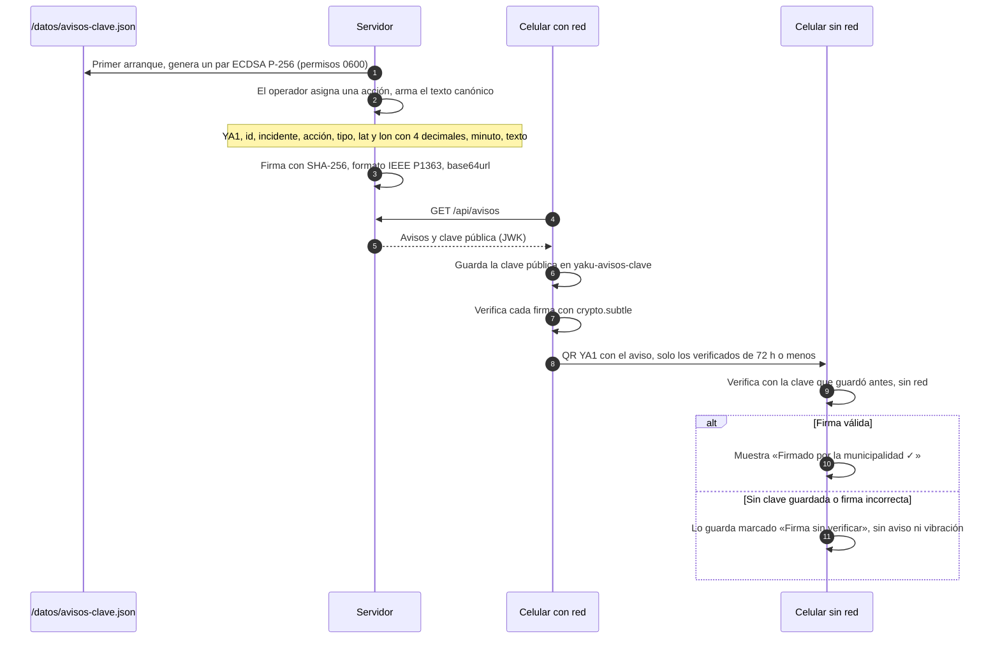

# Seguridad

Yaku mueve información de personas en una emergencia a través de celulares que nadie controla. La regla de diseño es simple: **el celular y la cadena de QR no son confiables; el servidor y la persona que opera el Centro de monitoreo sí**. Este documento dice qué se valida, qué se firma, qué protege cada modo y qué falta.

Para esto último hay una advertencia que se repite a propósito: los reportes son **reportes vecinales por validar**. No son alertas oficiales, no reemplazan a SINPAD ni a EDAN Digital, y que un dato llegue al servidor no lo vuelve cierto.

## Camino rápido

- Producción real: activa `YAKU_MODO_ESTRICTO=1`, define un `MUNI_PIN` largo y una `MUNI_CLAVE` distinta, y respalda `avisos-clave.json` (ver [MVP frente a estricto](#mvp-frente-a-estricto) y [secretos](#secretos)).
- Nunca subas un `.env`, una contraseña ni `avisos-clave.json` al repositorio.
- Qué falta: [pendientes](#pendientes-y-límites-conocidos).

## Actores y nivel de confianza

| Actor | Confianza | Qué puede hacer | Cómo se limita |
| --- | --- | --- | --- |
| Vecino con la app | Ninguna | Subir reportes, fotos y «Estoy bien»; leer avisos y estados | El servidor valida y recalcula ids. Sin cuenta, sin datos personales obligatorios |
| Celular intermedio en la cadena | Ninguna | Cambiar o inventar un QR | Id por contenido y CRC32 en reportes y cartas, firma en avisos. Lo que sube a la API pasa por la misma validación que cualquier cliente. Los estados `YE1` no se firman (ver [pendientes](#pendientes-y-límites-conocidos)) |
| Cualquier cliente de internet | Ninguna | Llamar a la API pública | Validación de forma y tamaño. En modo estricto, límites por IP |
| Familia que busca | Ninguna | Buscar mensajes por nombre | 3 letras mínimo, 50 resultados máximo, nunca un listado completo |
| Operador con sesión | Alta | Ver incidentes y fotos, validar, descartar, asignar, unir y separar | Usuario y contraseña con scrypt, token con vencimiento |
| Quien tiene el `MUNI_PIN` | Alta | Lo mismo que el operador | Es un respaldo; en modo estricto se bloquea por intentos |
| Servidor y volumen `/datos` | Total | Todo | El contenedor corre sin privilegios y el acceso es del administrador del VPS |
| Traefik (proxy) | Total | Termina el HTTPS y pone la IP del cliente | La IP solo se toma de una conexión desde red privada |

## Integridad

| Dato | Cómo se protege | Qué **no** garantiza |
| --- | --- | --- |
| Reporte | El id es un hash del contenido (`cyrb53`). El servidor y el celular lo **recalculan**: un id que no coincide se rechaza (`id no coincide con contenido`). El CRC32 detecta un QR dañado | No es una firma: `cyrb53` no es criptográfico y no hay secreto. Detecta daño y cambios descuidados; no impide que alguien arme un reporte nuevo con su id correcto |
| Carta «Estoy bien» | El id es SHA-256 del texto canónico `YB1\|nombre\|para\|mensaje\|zona\|ts\|deviceId`; el servidor lo recalcula y limpia saltos de línea y `\|` | Igual: no prueba quién la escribió. La app lo dice: «Lo escribió quien firma; la municipalidad no lo verifica» |
| Foto | El tipo se deduce de los **bytes** (JPEG, PNG o WebP), no del `mime` del cliente. Máximo 400 KB. El id es SHA-256 de los bytes | No analiza el contenido de la imagen |
| Aviso | Firma ECDSA P-256 (ver abajo) | — |
| Estado | Solo lo cambia un operador autenticado | — |
| Tamaños | 128 KB por cuerpo de sync y cartas, 200 reportes, 100 cartas, 640 KB máximo leído por el servidor | — |

## Avisos firmados

Un aviso de la municipalidad («Bomberos asignados») llega a celulares sin red pasando de mano en mano. La firma evita que alguien en esa cadena fabrique uno.

- **La clave privada nunca sale del servidor.** Los celulares solo guardan la pública (`kty`, `crv`, `x`, `y`).
- **Sin red también se verifica**, pero solo si el celular abrió la app con internet **al menos una vez** después de que el servidor tuviera clave. Sin clave guardada, ningún aviso verifica.
- Cualquier error al verificar (clave rara, firma mala) cuenta como no verificado. No hay modo de «confiar de todos modos».
- El texto firmado incluye el texto libre del operador (hasta 120 caracteres, sin saltos de línea ni `|`).

## Sesión y PIN de respaldo

| Tema | Cómo funciona |
| --- | --- |
| Contraseña | `scrypt` con sal aleatoria de 16 bytes por usuario; comparación en tiempo constante. En la base solo van sal y hash |
| Token de sesión | 32 bytes aleatorios en base64url. El navegador lo guarda; el servidor guarda solo su **hash SHA-256** y lo compara en cada petición |
| Duración | `YAKU_SESION_HORAS` (72 por defecto). Las sesiones vencidas se limpian al crear una nueva |
| Cerrar | «Salir» borra la sesión del servidor. Cambiar `MUNI_CLAVE` borra todas las del usuario |
| PIN de respaldo | Cabecera `X-Muni-Pin`. Se compara por hash SHA-256 en tiempo constante. Sirve para la misma lista protegida |
| Con `Bearer` | Solo cuenta el token. Un token inválido da 401 y no cae al PIN |

## MVP frente a estricto

El modo MVP (`YAKU_MODO_ESTRICTO=0`, el predeterminado) existe para demos y pruebas: nada estorba. El modo estricto (`1`) es el que corresponde a producción real. Solo el valor exacto `1` lo activa.

| Tema | MVP | Estricto |
| --- | --- | --- |
| Intentos de contraseña o PIN | Sin bloqueo | 10 fallos seguidos en 10 min desde una IP → 5 min de espera (429). Un acierto reinicia el contador |
| Histórico y listado de reportes (`/api/reports` sin `ids`) | Público | Pide sesión o PIN |
| `GET /api/reports?ids=` (para el acuse del celular) | Público | Público |
| `POST` públicos (`/api/sync`, `/api/fotos`, `/api/cartas`) | Sin límite | 120 por minuto por IP (429) |
| Fotos por reporte | Sin tope | 3 (409) |
| Fotos en total | Sin tope | 2 GB (507) |
| CORS | `access-control-allow-origin: *` | Sin CORS: la API y la PWA comparten origen |
| Cabeceras | `x-content-type-options: nosniff` | Además `Referrer-Policy: strict-origin-when-cross-origin`, `X-Frame-Options: DENY`, `Strict-Transport-Security: max-age=31536000` y `Cross-Origin-Opener-Policy: same-origin` |

HSTS solo tiene efecto cuando se sirve por HTTPS, es decir, detrás de Traefik. Los contadores de intentos y de peticiones viven **en memoria**: se reinician con el proceso.

## Privacidad

| Qué se guarda | Dónde | Notas |
| --- | --- | --- |
| Ubicación exacta (5 decimales) y nota de cada reporte | `reports` | Es lo que hace útil el reporte. En modo MVP el histórico es público |
| Código anónimo del equipo (`deviceId`) | `reports`, `cartas` | Se genera en el celular. No es teléfono ni nombre. Sirve para contar vecinos distintos |
| Fotos | `/datos/fotos` | Solo se ven con sesión. La app re-dibuja la foto en un canvas antes de guardarla, lo que descarta los metadatos EXIF |
| Nombre, mensaje y zona aproximada de «Estoy bien» | `cartas` | **Se pueden buscar públicamente por nombre.** La app pide aceptar y advierte que no se escriba teléfono ni dirección exacta |
| Usuario y hash de contraseña, hash de sesión | `usuarios`, `sesiones` | Nunca la contraseña ni el token en claro |
| Notas de zona del operador (texto, zona, id del incidente) | Atomic Memory, fuera del servidor (solo con `YAKU_MEMORIA=atomicmemory`) | Apagado por defecto. A nombre del usuario de la sesión; ningún otro usuario las ve. La pantalla pide no escribir datos personales de vecinos. No incluyen reportes, ubicaciones exactas ni fotos |

El consentimiento que ve el vecino dice: «Tus reportes guardan la ubicación del celular y un código anónimo del equipo. No pedimos nombre ni DNI. Avisar algo falso a propósito es delito (Código Penal, art. 315-A)».

## Secretos

| Secreto | Dónde vive | Qué hacer |
| --- | --- | --- |
| `MUNI_PIN` | Variable de entorno de Dokploy | Largo (8 caracteres o más). Es obligatoria |
| `MUNI_CLAVE` | Variable de entorno de Dokploy | Distinta del PIN. Si cambia, se cierran las sesiones |
| `ATOMICMEMORY_API_KEY` | Variable de entorno de Dokploy | Solo la usa el servidor y solo viaja por HTTPS (o a `127.0.0.1`). Nunca va al navegador ni a los registros |
| Clave privada de avisos | `/datos/avisos-clave.json` | Respáldala aparte. `servidor-local/.gitignore` ignora `datos/`, `.gitignore` ignora `.env`, `*.key` y `*.pem`, y `.dockerignore` deja `servidor-local/datos` fuera de la imagen |
| Contraseña de producción para el QA | Variable `YAKU_CLAVE` en tu terminal | No la escribas en archivos |
| Token de ngrok | Configuración propia de ngrok | Los scripts no lo leen |

Si `avisos-clave.json` se pierde, el servidor crea otra clave: los avisos nuevos verifican con la nueva y los celulares la bajan en su próxima sincronización, pero los avisos firmados antes dejan de verificarse.

## Pendientes y límites conocidos

Esto es lo que el código **no** hace hoy:

- **El modo MVP es el predeterminado.** Hay que activar el estricto a propósito.
- **El `deviceId` lo declara el celular.** No hay forma de comprobar que sean personas distintas, así que un cliente malicioso podría simular varios vecinos y subir el respaldo. La validación humana del operador es la defensa.
- **Los ids de reportes y cartas no son firmas** (ver [Integridad](#integridad)).
- **Los estados `YE1` que viajan por QR no van firmados.** Un celular malicioso podría mostrarle a otro vecino un estado falso en su reporte (por ejemplo «Atendido»). Los avisos `YA1`, que son la respuesta oficial, sí van firmados.
- **No hay rotación ni revocación de la clave de avisos**, y al recibir un aviso por QR no encontré una comprobación de antigüedad: el celular que lo pasa filtra a 72 horas, pero quien lo recibe no vuelve a revisarlo.
- **Un solo rol** (`operador`): todos los usuarios con sesión pueden todo.
- **El token de sesión está en `localStorage`**, como cualquier dato de la página: una falla de XSS lo expondría.
- **Los límites del modo estricto son en memoria** y por IP; dependen de que `X-Forwarded-For` llegue bien.
- **Sin credenciales en el Worker de Cloudflare**: ahí `/api/reports` es público siempre.
- **El histórico exacto es público en modo MVP**, y `GET /api/cartas?q=` devuelve también el `deviceId` de cada carta.
- **No hay copias automáticas** de la base: ver [Datos](DATOS.md#cómo-respaldar-el-volumen).
- **Notas de zona**: la búsqueda en Atomic Memory filtra por usuario y `source_site`, y el servidor descarta lo que no sea una nota de Yaku de esa zona exacta. Apagar `YAKU_MEMORIA` oculta las notas pero **no las borra** de Atomic Memory.

## Documentos relacionados

- [Arquitectura](ARQUITECTURA.md): los límites de confianza en un diagrama.
- [API](API.md): códigos 401, 403 y 429 por endpoint.
- [Relevo por QR](RELEVO_QR.md): los formatos que viajan por la cadena.
- [Despliegue](DESPLIEGUE.md): proxy, volumen y variables.
