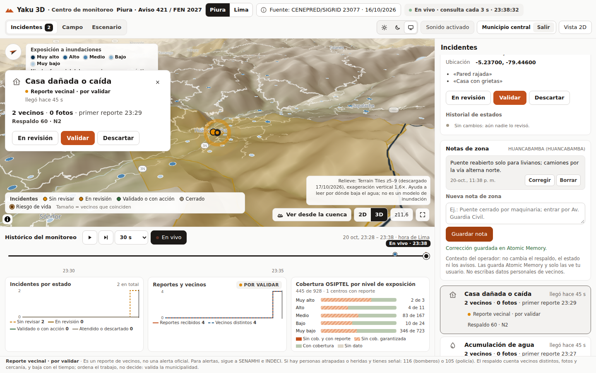
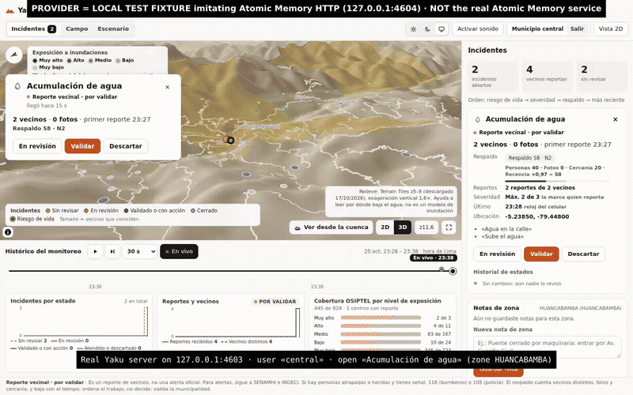

# Notas personales de zona

La captura y el video muestran el Centro de monitoreo real en localhost con reportes vecinales sintéticos. Atomic Memory usa `servidor-local/memoria-fixture.ts`, un proveedor HTTP local de prueba. No son incidentes reales ni llamadas a una cuenta real de Atomic Memory.

El video muestra guardar una nota de acceso, encontrarla en otro incidente de la misma zona y corregirla. Las notas no cambian estados, respaldo ni avisos.

## Reproducir

1. Ejecuta `npm ci` y `npm run build`.
2. En otra terminal, ejecuta `FIXTURE_PUERTO=4604 node servidor-local/memoria-fixture.ts`.
3. Inicia el servidor con las variables de demostración siguientes. Usa una carpeta de datos local vacía para no modificar datos anteriores.

```sh
HOST=127.0.0.1 PORT=4603 YAKU_DIST=dist YAKU_DATOS=/tmp/yaku-notas-demo \
MUNI_PIN=pin-demo-local-2026 MUNI_USUARIO=central MUNI_CLAVE=Clave-demo-2026 \
YAKU_MEMORIA=atomicmemory ATOMICMEMORY_API_URL=http://127.0.0.1:4604 \
ATOMICMEMORY_API_KEY=fixture-local node servidor-local/servidor.ts
```

4. Abre `http://127.0.0.1:4603`, entra al Centro de monitoreo con el usuario `central` y la contraseña de prueba. Crea reportes de prueba desde el flujo existente, abre un incidente y guarda una nota de zona. Otro incidente cercano recuerda la nota.

Estas credenciales son públicas y solo sirven para la demostración local. La configuración real se explica en `documentacion/CONFIGURACION.md`.





[Video MP4](demo.mp4)
